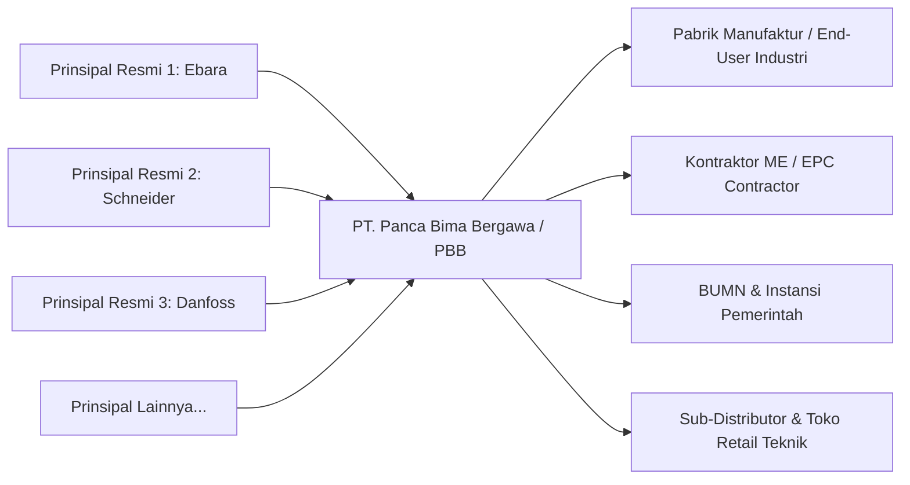

# 01. Konteks Bisnis & Analisis Pemangku Kepentingan
## Business Requirement Document (BRD)

| Parameter Dokumen | Keterangan Formal |
| :--- | :--- |
| **Nama Proyek** | B2B Multi-Brand Product Showcase & Internal Commercial ERP |
| **Entitas Perusahaan** | **PT. Panca Bima Bergawa** (Disingkat: **PBB**) |
| **Alamat Kantor Pusat** | Gd. Wirausaha lt.1 Unit 104, Jl. H.R. Rasuna Said Kav. C5, Setiabudi, Jakarta Selatan 12920 |
| **Nomor Dokumen** | `DOC-PBB-BRD-01` |
| **Versi Dokumen** | 1.3.0 |
| **Tanggal Efektif** | September 2026 |
| **Klasifikasi Akses** | Internal Confidential & Engineering Reference |

### Riwayat Revisi Dokumen (Document Version Control)

| Versi | Tanggal | Penulis / Peran | Status | Ringkasan Perubahan |
| :---: | :---: | :--- | :---: | :--- |
| `1.0.0` | 01 Sep 2026 | Tim Business Analyst | Draf Awal | Penyusunan profil entitas & ekosistem rantai pasok B2B |
| `1.1.0` | 03 Sep 2026 | Legal & General Affairs | Ditinjau | Pembaruan alamat kantor pusat Gd. Wirausaha Rasuna Said Kav. C5 |
| `1.2.0` | 05 Sep 2026 | Commercial Operations Lead | Disetujui | Finalisasi matriks RACI & struktur peran Freelance Sales Agent |
| `1.3.0` | 05 Sep 2026 | Principal System Architect | Disetujui | Penyelarasan kepatuhan UU HPP PPN snapshot, toleransi pencarian SKU, & eliminasi total emoji |

---

## 1. Profil Perusahaan & Model Bisnis

### 1.1 Identitas Resmi Entitas Perusahaan
- **Nama Perusahaan:** **PT. Panca Bima Bergawa** (disingkat **PBB**)
- **Alamat Kantor Pusat:** Gd. Wirausaha lt.1 Unit 104, Jalan Haji R. Rasuna Said Kavling C5, RT.3/RW.1, Karet, Kecamatan Setiabudi, Daerah Khusus Ibukota Jakarta 12920.
- **Klasifikasi Usaha:** Distributor & Supplier Komersial Multi-Brand B2B (Komponen Industri, Mekanikal, Elektrikal, Instrumentasi, dan Otomasi).

### 1.2 Model Bisnis & Posisi dalam Rantai Pasok (Supply Chain Ecosystem)

PT. Panca Bima Bergawa (PBB) beroperasi sebagai mitra distribusi resmi yang memasok ribuan SKU komponen industri (pompa sentrifugal, inverter & variable frequency drive, sensor otomatisasi, katup/valve industri, pipa & kelengkapannya) dari berbagai prinsipal global terkemuka kepada para pelaku industri di Indonesia.



### 1.2 Karakteristik Segmen Pelanggan B2B

1. **Pabrik Manufaktur & End-User Industri:**
   - **Karakter Kebutuhan:** Mengutamakan kecepatan waktu pengiriman (*lead time*) untuk kebutuhan penggantian suku cadang mendesak (*emergency maintenance / breakdown*).
   - **Pola Pembelian:** Seringkali membutuhkan 1–2 item spesifik dengan respon cepat via WhatsApp atau telepon langsung.
2. **Kontraktor Mekanikal-Elektrikal & Engineering, Procurement, Construction (EPC):**
   - **Karakter Kebutuhan:** Membutuhkan daftar penawaran harga resmi (*Official Quotation*) untuk puluhan item suku cadang sekaligus dalam rangka penyusunan anggaran tender/proyek.
   - **Pola Pembelian:** Memanfaatkan keranjang penawaran massal (*Bulk RFQ Cart*) untuk melampirkan daftar kebutuhan teknis lengkap.
3. **BUMN & Instansi Pemerintah:**
   - **Karakter Kebutuhan:** Mensyaratkan dokumen legalitas resmi, kepatuhan perpajakan (Faktur Pajak & NPWP), serta surat keagenan resmi dari prinsipal.

---

## 2. Profil Pemangku Kepentingan (Stakeholders Profile)

```
+----------------------------------------------------------------------------------------------------+
|                               PROFIL & KEBUTUHAN PEMANGKU KEPENTINGAN                              |
+--------------------------+------------------------------------+------------------------------------+
| Pemangku Kepentingan     | Peran & Tanggung Jawab             | Ekspektasi Utama dari Sistem       |
+--------------------------+------------------------------------+------------------------------------+
| 1. Direksi / Manajemen   | Mengawasi profitabilitas, margin,  | Dashboard performa penjualan,      |
|    Puncak                | strategi harga, dan target omzet.  | otorisasi diskon khusus, dan audit |
|                          |                                    | pipeline konversi prospek.         |
+--------------------------+------------------------------------+------------------------------------+
| 2. Tim Sales & Komersial | Menindaklanjuti prospek masuk,     | Notifikasi prospek instan, 1-click |
|                          | bernegosiasi, menerbitkan quote,   | Quotation PDF builder, dan status  |
|                          | dan mengawal order sampai PO rilis.| riwayat follow-up yang rapi.       |
+--------------------------+------------------------------------+------------------------------------+
| 3. Tim Digital Marketing | Mengelola publikasi artikel, SEO   | Visibilitas jejak UTM kampanye,    |
|    & Konten              | katalog, dan kampanye iklan digital| kemudahan import ribuan SKU via    |
|                          | untuk menjaring prospek baru.      | Excel, dan CMS terpadu.            |
+--------------------------+------------------------------------+------------------------------------+
| 4. Tim Logistik & Operasi| Mengatur pemenuhan pesanan dari    | Otomasi penerbitan Surat Jalan     |
|                          | prinsipal dan pengiriman ke klien. | resmi (Delivery Order) tanpa harga.|
+--------------------------+------------------------------------+------------------------------------+
| 5. Calon Pembeli (Klien) | Staf pengadaan/teknisi pabrik yang | Kemudahan mencari part number SKU, |
|                          | mencari barang dan meminta harga.  | minta harga tanpa wajib daftar akun|
|                          |                                    | (Guest Checkout model).            |
+--------------------------+------------------------------------+------------------------------------+
| 6. Mitra Freelance Sales | Tenaga penjual lepas luar /        | Portal dashboard mandiri, link     |
|                          | profesional industri mitra.        | referal produk, dan transparansi   |
|                          |                                    | pencairan komisi per transaksi.    |
+--------------------------+------------------------------------+------------------------------------+
```

---

## 3. Matriks Tanggung Jawab Organisasi (RACI Matrix)

Matriks RACI mendefinisikan batas wewenang dan tanggung jawab antar-divisi dalam menjalankan seluruh alur komersial sistem:

| Aktivitas Operasional Komersial | Direksi | Tim Sales | Tim Marketing | Tim Logistik | Mitra Freelance | Klien B2B |
|:---|:---:|:---:|:---:|:---:|:---:|:---:|
| **Pencarian Produk & Pengajuan RFQ** | I | I | I | I | I | **A / R** |
| **Penerimaan & Follow-up Lead Masuk** | I | **A / R** | C | I | I | C |
| **Penyusunan Draft Surat Penawaran** | I | **A / R** | I | I | I | I |
| **Approval Diskon Melebihi Batas Normal** | **A / R** | C | I | I | I | I |
| **Penerbitan & Pengiriman Quotation Resmi**| I | **A / R** | I | I | I | C |
| **Konfirmasi PO & Penerbitan Sales Order** | I | **A / R** | I | C | I | C |
| **Penerbitan Surat Jalan (Delivery Order)** | I | C | I | **A / R** | I | I |
| **Pendaftaran & Screening Mitra Freelance**| **A / R** | I | I | I | **R** | I |
| **Input Prospek & Share Link Referal**     | I | I | I | I | **A / R** | I |
| **Otorisasi & Pencairan Komisi Deal**      | **A / R** | I | I | I | **R** | I |
| **Pengelolaan Master Katalog & Import Excel**| I | I | **A / R** | I | I | I |
| **Publikasi Artikel & Analisis Traffic SEO**| I | I | **A / R** | I | I | I |
| **Pengaturan Konten CMS & Legalitas (TnC)**| **A / R** | I | **R** | I | I | I |
| **Manajemen Pengguna & Konfigurasi Sistem** | **A / R** | I | I | I | I | I |

> **Keterangan RACI:**
> - **R (Responsible):** Pihak yang bertugas langsung mengeksekusi aktivitas.
> - **A (Accountable):** Pihak pengambil keputusan akhir dan penanggung jawab keberhasilan.
> - **C (Consulted):** Pihak yang dimintai masukan atau konfirmasi dua arah.
> - **I (Informed):** Pihak yang menerima pembaruan informasi satu arah.
