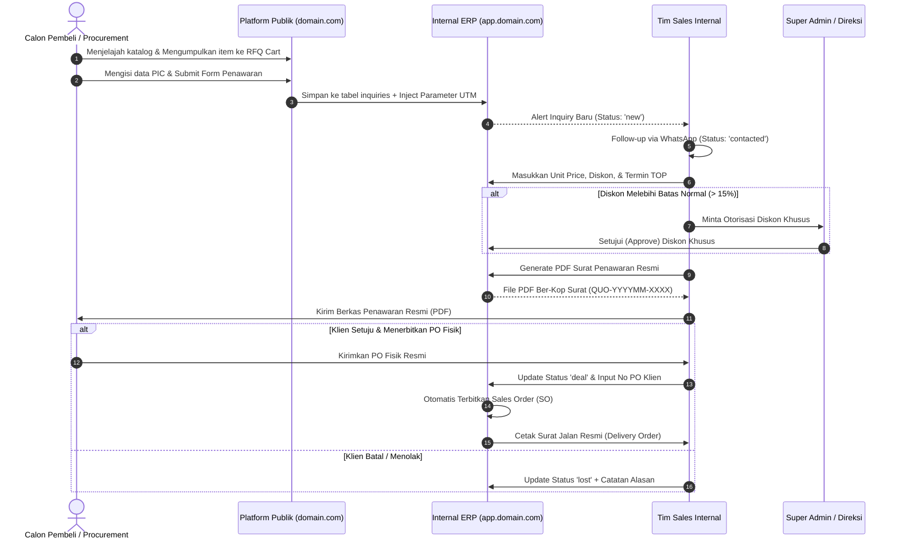

# 04. Pemodelan Alur Proses Bisnis Komersial
## Business Requirement Document (BRD)

| Parameter Dokumen | Keterangan Formal |
| :--- | :--- |
| **Nama Proyek** | B2B Multi-Brand Product Showcase & Internal Commercial ERP |
| **Entitas Perusahaan** | **PT. Panca Bima Bergawa** (Disingkat: **PBB**) |
| **Alamat Kantor Pusat** | Gd. Wirausaha lt.1 Unit 104, Jl. H.R. Rasuna Said Kav. C5, Setiabudi, Jakarta Selatan 12920 |
| **Nomor Dokumen** | `DOC-PBB-BRD-04` |
| **Versi Dokumen** | 1.3.0 |
| **Tanggal Efektif** | September 2026 |
| **Klasifikasi Akses** | Internal Confidential & Engineering Reference |

### Riwayat Revisi Dokumen (Document Version Control)

| Versi | Tanggal | Penulis / Peran | Status | Ringkasan Perubahan |
| :---: | :---: | :--- | :---: | :--- |
| `1.0.0` | 01 Sep 2026 | Business Process Analyst | Draf Awal | Pemodelan alur Lead-to-Cash As-Is vs To-Be |
| `1.1.0` | 03 Sep 2026 | Operations Director | Ditinjau | Penambahan alur pengiriman parsial Delivery Order via kurir pihak ketiga |
| `1.2.0` | 05 Sep 2026 | ERP Architect | Disetujui | Finalisasi alur dual-track RFQ & sinkronisasi otomatis ke Kanban ERP |
| `1.3.0` | 05 Sep 2026 | Principal System Architect | Disetujui | Penyelarasan kepatuhan UU HPP PPN snapshot, toleransi pencarian SKU, & eliminasi total emoji |

---

## 1. Perbandingan Alur Proses Bisnis: As-Is vs To-Be

```
+----------------------------------------------------------------------------------------------------+
|                                PERBANDINGAN ALUR PROSES BISNIS KOMERSIAL                           |
+------------------------------------+---------------------------------------------------------------+
| Fase / Tahapan Alur                | Proses Eksisting (As-Is)      | Proses Masa Depan (To-Be)     |
+------------------------------------+---------------------------------------------------------------+
| 1. Penemuan Produk (Discovery)     | Manual membaca katalog PDF    | Pencarian instan & filter     |
|                                    | fisik atau kiriman WhatsApp.  | multi-brand di web publik.    |
+------------------------------------+---------------------------------------------------------------+
| 2. Pengajuan Permintaan Harga      | Kirim teks WA bebas atau email| Dual Track: Fast Track WA/Form|
|    (Inquiry / RFQ Submission)      | tanpa format terstruktur.     | & Bulk RFQ Cart (localStorage)|
+------------------------------------+---------------------------------------------------------------+
| 3. Pencatatan Lead & Atribusi      | Tersimpan di memori/chat sales| Ingest otomatis ke CRM ERP    |
|    (Lead Ingestion & Attribution)  | tanpa jejak sumber promosi.   | beserta jejak UTM & IP.       |
+------------------------------------+---------------------------------------------------------------+
| 4. Penyusunan Penawaran Harga      | Buka file Word/Excel, salin   | 1-Click Quote Builder di ERP, |
|    (Quotation Generation)          | harga, hitung manual (30-60m).| render DomPDF otomatis (< 2m).|
+------------------------------------+---------------------------------------------------------------+
| 5. Negosiasi & Manajemen Revisi    | Buat file Word baru (Rev 1,   | Version control otomatis di   |
|    (Negotiation & Revision)        | Rev 2) di komputer sales.     | database (Rev 0, 1, 2).       |
+------------------------------------+---------------------------------------------------------------+
| 6. Closing & Eksekusi Pesanan      | Buat surat jalan manual di    | Konversi status Deal -> SO &   |
|    (Deal, SO & Delivery Order)     | buku cetak fisik.             | Surat Jalan resmi via sistem. |
+------------------------------------+---------------------------------------------------------------+
```

---

## 2. Alur Transaksi Komersial End-to-End (Lead-to-Order)



---

## 3. Rincian Sub-Proses Komersial

### 3.1 Sub-Proses 1: Dual-Track RFQ Ingestion
Sistem membedakan dua profil perilaku calon pembeli:
1. **Jalur A - Fast Track (Kebutuhan Cepat / 1 Item):**
   - Calon pembeli mengklik tombol *"Chat WhatsApp"* -> pesan otomatis berisi nama produk, nomor part, dan URL halaman.
   - Calon pembeli mengklik *"Tanya Produk Ini"* -> modal pop-up meminta Nama, Perusahaan, No. WA, Jumlah Unit, dan Catatan Spesifikasi.
   - Data disimpan ke `inquiries` dengan kolom `type = 'single_direct'`.
2. **Jalur B - Bulk Procurement (Pengadaan Banyak Item):**
   - Calon pembeli mengumpulkan berbagai macam produk ke dalam keranjang penawaran (*RFQ Cart*) tanpa perlu login (*Guest Mode*).
   - Seluruh daftar belanjaan tersimpan aman di browser (*localStorage*).
   - Pada halaman `/rfq`, calon pembeli memasukkan jumlah kuantiti per item dan catatan teknis, lalu mengisi profil perusahaan dan menekan *"Kirim Permintaan Penawaran Resmi"*.
   - Data disimpan ke `inquiries` dengan `type = 'bulk_cart'` dan $N$ baris detail di `inquiry_items`.

### 3.2 Sub-Proses 2: Alur Persetujuan Diskon Khusus (Special Discount Escalation)
1. Tim Sales memiliki wewenang diskon mandiri maksimal hingga batas tertentu (misal: 10% dari pricelist).
2. Jika klien meminta diskon tambahan untuk memenangkan tender bernilai besar (misal: diskon 18%), form Quotation akan meminta *Escalation Approval*.
3. Super Admin / Direksi menerima notifikasi dan dapat menyetujui atau menolak permohonan diskon tersebut langsung dari panel ERP.

### 3.3 Sub-Proses 3: Penerbitan Sales Order & Surat Jalan (Delivery Order)
1. Setelah Purchase Order resmi dari klien diterima, status penawaran diubah menjadi `deal`.
2. Sistem otomatis mengunci nilai harga agar tidak dapat diubah lagi dan menerbitkan dokumen **Sales Order (`SO-YYYYMM-XXXX`)**.
3. Dari record Sales Order, tim logistik dapat mencetak dokumen **Surat Jalan / Delivery Order (DO)** tanpa memuat nominal harga demi privasi komersial saat diantar oleh pihak ekspedisi kargo ke pabrik klien. Tim logistik menginputkan nama ekspedisi, nomor resi resmi, serta URL tautan lacak resi ekspedisi agar klien dapat melakukan pelacakan mandiri.

### 3.4 Sub-Proses 4: Alur Pendaftaran, Screening, dan Kemitraan Freelance Sales
1. **Pendaftaran Publik (`/gabung-mitra`):** Calon mitra mengisi identitas KTP, nomor rekening bank, serta kriteria filter (fokus industri, pengalaman B2B, cakupan area).
2. **Screening & Otorisasi Direksi (Panel ERP):** Super Admin mengevaluasi kelayakan data pendaftar. Jika lolos (*Approve*), sistem menetapkan persentase komisi default, men-generate kode referal unik, membuat akun user role `freelance_sales`, dan mengirimkan Welcome Email.
3. **Pemasaran & Input Prospek Mandiri:** Mitra membagikan tautan produk ber-referal (`?ref=...`) atau menginputkan data prospek offline secara mandiri di portal ERP khususnya.
4. **Pencatatan & Pembayaran Komisi:** Saat prospek dari mitra disetujui klien (*Deal*), sistem menghitung hak komisi (berstatus `pending_payment` -> `payable` saat klien melunasi PO -> `paid` setelah transfer komisi dikonfirmasi).

### 3.5 Sub-Proses 5: Sentralisasi Prospek Multi-Saluran (Multi-Source Lead Ingestion)
1. **Pencatatan Manual Prospek Offline:** Prospek yang berasal dari panggilan telepon kantor, pameran industri (*exhibition*), atau chat WhatsApp direct dapat diinputkan manual oleh staf sales internal ke dalam pipeline Kanban ERP.
2. **Kategorisasi Sumber Asal:** Setiap entri prospek wajib memilih sumber: `web_rfq_single`, `web_rfq_bulk`, `whatsapp_direct`, `walk_in_phone`, `exhibition_offline`, atau `freelance_referral`.
3. **Satu Alur Pemrosesan:** Seluruh prospek dari berbagai saluran tersebut mengikuti siklus standar pembuatan Quotation PDF dan Sales Order yang seragam.

