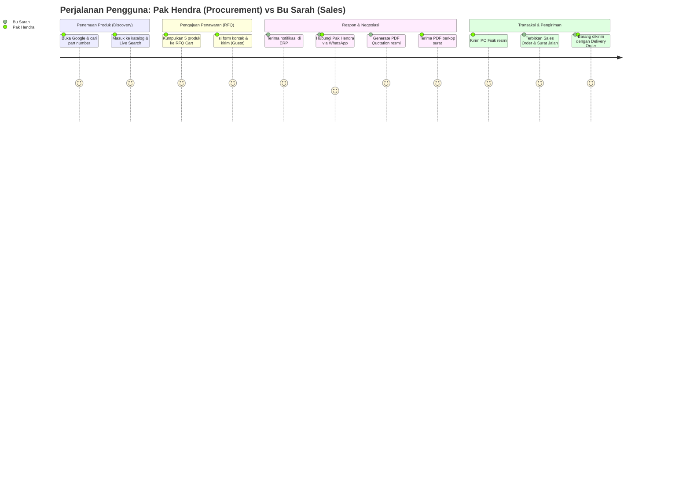

# 01. Persona Pengguna & Skenario Perjalanan
## Product Requirement Document (PRD)

| Parameter Dokumen | Keterangan Formal |
| :--- | :--- |
| **Nama Proyek** | B2B Multi-Brand Product Showcase & Internal Commercial ERP |
| **Entitas Perusahaan** | **PT. Panca Bima Bergawa** (Disingkat: **PBB**) |
| **Alamat Kantor Pusat** | Gd. Wirausaha lt.1 Unit 104, Jl. H.R. Rasuna Said Kav. C5, Setiabudi, Jakarta Selatan 12920 |
| **Nomor Dokumen** | `DOC-PBB-PRD-01` |
| **Versi Dokumen** | 1.3.0 |
| **Tanggal Efektif** | September 2026 |
| **Klasifikasi Akses** | Internal Confidential & Engineering Reference |

### Riwayat Revisi Dokumen (Document Version Control)

| Versi | Tanggal | Penulis / Peran | Status | Ringkasan Perubahan |
| :---: | :---: | :--- | :---: | :--- |
| `1.0.0` | 01 Sep 2026 | UX Research Team | Draf Awal | Perumusan 5 persona pengguna inti (Procurement, Engineer, Sales, dsb) |
| `1.1.0` | 03 Sep 2026 | Lead UX Specialist | Ditinjau | Penambahan Persona Mas Dimas (Freelance Sales Agent) & skenario referral |
| `1.2.0` | 05 Sep 2026 | Product Management Lead | Disetujui | Pemetaan journeys alur pemantauan komisi & pelacakan status pengadaan |
| `1.3.0` | 05 Sep 2026 | Principal System Architect | Disetujui | Penyelarasan kepatuhan UU HPP PPN snapshot, toleransi pencarian SKU, & eliminasi total emoji |

---

## 1. Profil Persona Pengguna Mendalam (User Personas)

```
┌─────────────────────────────────────────────────────────────────────────────────┐
│                              6 PERSONA PENGGUNA SISTEM                          │
├─────────────────────────────────────────────────────────────────────────────────┤
│ 1. Pak Hendra  - Procurement Officer (Manajer Pengadaan Pabrik Manufaktur)      │
│ 2. Pak Agus    - Site Project Engineer (Kontraktor Mekanikal-Elektrikal/EPC)   │
│ 3. Bu Sarah    - Sales Representative (Commercial Engineer B2B Internal)        │
│ 4. Mas Dimas   - Freelance Sales Agent (Mitra Penjualan Luar / Referral Partner)│
│ 5. Mas Doni    - Digital Marketing & Content Specialist (Internal)              │
│ 6. Ibu Lisa    - Executive Director (Direktur Operasional & Finansial Internal) │
└─────────────────────────────────────────────────────────────────────────────────┘

---

### Persona 1: Pak Hendra (Procurement Officer / Manajer Pengadaan Pabrik)
- **Demografi:** 42 tahun, Manajer Pengadaan di kawasan industri Cikarang.
- **Tujuan (Goals):**
  - Mengumpulkan daftar penawaran harga resmi (*Official Quotation*) untuk 10–20 item suku cadang pompa Ebara dan inverter Schneider sekaligus.
  - Membutuhkan penawaran resmi ber-Kop Surat dengan rincian PPN 11% yang sah untuk diajukan ke bagian keuangan perusahaannya.
- **Pain Points:**
  - Frustrasi jika diharuskan membuat akun login baru dan mengingat password hanya untuk meminta penawaran harga.
  - Bosan menunggu respons lambat dari supplier yang harus ditelepon berulang kali.
- **Fitur Kunci yang Digunakan:** *RFQ Cart (localStorage)*, *Faceted Filter Katalog*, *Guest Submission*, *Download PDF Quotation*.

---

### Persona 2: Pak Agus (Site Project Engineer / Kontraktor EPC)
- **Demografi:** 35 tahun, Teknisi Lapangan Proyek Instalasi Air & Otomasi.
- **Tujuan (Goals):**
  - Mencari nomor part/model spesifik yang sedang rusak di lapangan untuk diganti segera (*urgent replacement*).
  - Mengunduh lembar data teknis (*datasheet PDF*) untuk mencocokkan dimensi flensa dan voltase listrik.
  - Menghubungi sales secara instan via WhatsApp untuk menanyakan ketersediaan stok *ready*.
- **Pain Points:**
  - Sinyal di lokasi proyek kadang tidak stabil; membutuhkan website yang ringan dan cepat dibuka dari smartphone.
- **Fitur Kunci yang Digunakan:** *Live Search Part Number*, *Download Brosur PDF*, *Direct WhatsApp Click-to-Chat*, *Single RFQ Modal*.

---

### Persona 3: Bu Sarah (Sales Representative / Commercial Engineer Internal)
- **Demografi:** 28 tahun, Account Executive B2B.
- **Tujuan (Goals):**
  - Mengetahui seketika saat ada permintaan penawaran baru masuk lengkap dengan nomor WhatsApp pemohon dan barang yang diminta.
  - Menyusun dokumen penawaran harga resmi (Quotation) dalam waktu < 2 menit tanpa perlu membuka Excel atau mengetik manual di Word.
  - Mengonversi penawaran yang disetujui klien (*Deal*) menjadi dokumen Sales Order dan Surat Jalan resmi.
- **Pain Points:**
  - Menghabiskan 50% waktu kerjanya untuk urusan administratif menyalin data barang dan menghitung diskon/PPN.
- **Fitur Kunci yang Digunakan:** *Inquiry Kanban Pipeline*, *1-Click Quotation Builder*, *Version Control (Rev 0/1/2)*, *Delivery Order Generator*.

---

### Persona 4: Mas Dimas (Freelance Sales Agent / Mitra Penjual Luar)
- **Demografi:** 33 tahun, Konsultan Teknik & Freelance Agent di berbagai proyek pabrik.
- **Tujuan (Goals):**
  - Mendaftar sebagai mitra resmi distributor via web (`/gabung-mitra`) dengan verifikasi KTP dan keahlian industri.
  - Membagikan link katalog produk yang sudah tersemat kode referal pribadinya (`domain.com/catalog?ref=REF-DIMAS-88`) ke kenalan kontraktor/pabrik.
  - Memasukkan data prospek lapangan secara mandiri di portal ERP khususnya.
  - Memantau status penawaran yang dia rujuk dan menerima pencairan komisi penjualan (*commission payout*) secara transparan saat klien melakukan *deal*.
- **Pain Points:**
  - Sering ragu apakah prospek yang dia rekomendasikan benar-benar tercatat atas namanya atau diklaim oleh sales lain.
- **Fitur Kunci yang Digunakan:** *Portal Agen Terisolasi*, *Referral Link Tracking (`?ref=...`)*, *Pencatatan Lead Freelance*, *Rekap Komisi Per Deal*.

---

### Persona 5: Mas Doni (Digital Marketing & Content Specialist Internal)
- **Demografi:** 26 tahun, Digital Marketer.
- **Tujuan (Goals):**
  - Mempublikasikan artikel edukasi teknis industri dan berita prinsipal untuk mendatangkan traffic organik dari Google.
  - Mengunggah 500 produk baru sekaligus dari file Excel pricelist prinsipal.
  - Memantau kampanye iklan mana (Google Ads vs Instagram Ads) yang paling banyak menghasilkan submission penawaran harga.
- **Pain Points:**
  - Kewalahan jika harus mengetik meta description SEO untuk ribuan SKU produk secara manual.
- **Fitur Kunci yang Digunakan:** *Hybrid SEO Auto-Fallback*, *Bulk Excel Import*, *UTM Attribution Dashboard*, *Insights CMS*, *Pengaturan Legalitas/CMS*.

---

### Persona 6: Ibu Lisa (Executive Director / Super Admin Internal)
- **Demografi:** 48 tahun, Direktur Operasional & Pemilik Bisnis.
- **Tujuan (Goals):**
  - Memiliki visibilitas penuh atas total nilai prospek yang sedang berjalan (*Pipeline Deal Value*).
  - Melakukan evaluasi & approval pendaftaran mitra freelance luar baru berdasarkan kriteria screening perusahaan.
  - Memberikan persetujuan (*approval*) cepat jika tim sales mengajukan diskon khusus untuk memenangkan tender besar.
  - Memastikan seluruh data kontak pelanggan korporat aman tersimpan di server perusahaan.
- **Pain Points:**
  - Buta terhadap performa tim sales jika data hanya tersimpan di chat WhatsApp masing-masing sales.
- **Fitur Kunci yang Digunakan:** *Executive Dashboard Widgets*, *Screening & Approval Mitra Freelance*, *Special Discount Approval*, *Audit Logs*, *User & Role Management*.

---

## 2. Pemetaan Perjalanan Pengguna (User Journey Mapping)


