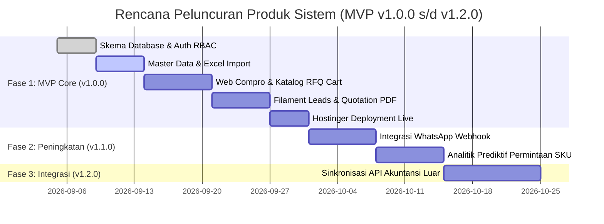

# 05. Metrik Keberhasilan Produk & Rencana Rilis MVP
## Product Requirement Document (PRD)

| Parameter Dokumen | Keterangan Formal |
| :--- | :--- |
| **Nama Proyek** | B2B Multi-Brand Product Showcase & Internal Commercial ERP |
| **Entitas Perusahaan** | **PT. Panca Bima Bergawa** (Disingkat: **PBB**) |
| **Alamat Kantor Pusat** | Gd. Wirausaha lt.1 Unit 104, Jl. H.R. Rasuna Said Kav. C5, Setiabudi, Jakarta Selatan 12920 |
| **Nomor Dokumen** | `DOC-PBB-PRD-05` |
| **Versi Dokumen** | 1.3.0 |
| **Tanggal Efektif** | September 2026 |
| **Klasifikasi Akses** | Internal Confidential & Engineering Reference |

### Riwayat Revisi Dokumen (Document Version Control)

| Versi | Tanggal | Penulis / Peran | Status | Ringkasan Perubahan |
| :---: | :---: | :--- | :---: | :--- |
| `1.0.0` | 01 Sep 2026 | Product Management Team | Draf Awal | Perumusan North Star Metric (Lead-to-Quote Turnaround) & target MVP |
| `1.1.0` | 03 Sep 2026 | Project Director | Ditinjau | Penyelarasan timeline rilis bertahap (Fase 1 Web B2B s/d Fase 3 Analytics) |
| `1.2.0` | 05 Sep 2026 | Principal System Architect | Disetujui | Finalisasi target SLA respon RFQ < 2 jam & standarisasi metrik keberhasilan |
| `1.3.0` | 05 Sep 2026 | Principal System Architect | Disetujui | Penyelarasan kepatuhan UU HPP PPN snapshot, toleransi pencarian SKU, & eliminasi total emoji |

---

## 1. Metrik Keberhasilan Produk (Product Success Metrics / North Star)

Untuk mengukur dampak fungsional dan adopsi produk setelah peluncuran sistem, ditetapkan metrik inti berikut:

```
+─────────────────────────────────────────────────────────────────────────────+
|                          METRIK KEBERHASILAN PRODUK (PRODUCT KPIs)          |
+──────────────────────────+────────────────────────+─────────────────────────+
| Metrik Produk            | Definisi & Pengukuran  | Target Sasaran          |
+──────────────────────────+────────────────────────+─────────────────────────+
| RFQ Conversion Rate      | % pengunjung katalog   | > 3.5% dari total       |
|                          | yang mengirimkan RFQ.  | pengunjung unik web.    |
| Quotation Generation Time| Waktu dari prospek     | < 3 Menit per dokumen   |
|                          | masuk hingga terbit PDF| (sebelumnya > 30 menit).|
| Attribution Capture Rate | % prospek yang memuat  | 100% dari seluruh       |
|                          | parameter UTM lengkap. | submission form RFQ.    |
| Bulk Upload Speed        | Kecepatan import massal| 1.000 SKU / < 60 detik  |
|                          | data produk via Excel. | tanpa memory limit host.|
| Page Speed & Core Web    | Skor performa katalog  | > 90/100 (Mobile &      |
| Vitals (Google PageSpeed)| diakses publik.        | Desktop via WebP assets)|
| Google SERP Page 1       | Posisi kata kunci brand| Masuk Halaman 1 (Top 5) |
| Dominance (SEO B2B)      | & part number industri.| untuk 80% SKU terindeks |
+──────────────────────────+────────────────────────+─────────────────────────+
```

---

## 2. Rencana Peluncuran Bertahap (Release Roadmap)



### 2.1 Lingkup Rilis MVP (Versi 1.0.0)
- **Platform Publik Lengkap:** Compro, Katalog Multi-Brand, Fast Track WA, RFQ Cart localStorage, Insights CMS, Form Kontak, Pendaftaran Mitra Freelance (`/gabung-mitra`), Halaman Dokumen Legalitas (TnC, Kebijakan Privasi, Garansi), dan Proteksi Anti-Spam Berlapis (Honeypot, Turnstile, Rate Limiting).
- **Internal Filament ERP:** Autentikasi Passwordless Email OTP, Master Brand/Kategori/Produk, Bulk Excel Import, CRM Kanban Pipeline, Quotation Builder DomPDF, Sales Order & Delivery Order PDF, Screening & Approval Mitra Freelance, Portal Terisolasi Agen Freelance, Full Dynamic Site CMS (`company_settings`), dan Spatie RBAC 4 Roles.
- **Infrastruktur Hostinger:** Single Codebase Routing Domain/Subdomain, WebP Pipeline, Cron Scheduler Queue non-blocking (`--stop-when-empty --max-time=50`).

### 2.2 Rencana Fitur Lanjutan (Post-MVP Roadmap)
- **Versi 1.1.0:** Integrasi gateway WhatsApp resmi (Meta Cloud API / Fonnte) untuk notifikasi penawaran harga otomatis langsung ke chat WhatsApp klien.
- **Versi 1.2.0:** Integrasi API eksternal ke sistem software akuntansi (misal: Accurate / Jurnal) untuk sinkronisasi data Sales Order.
