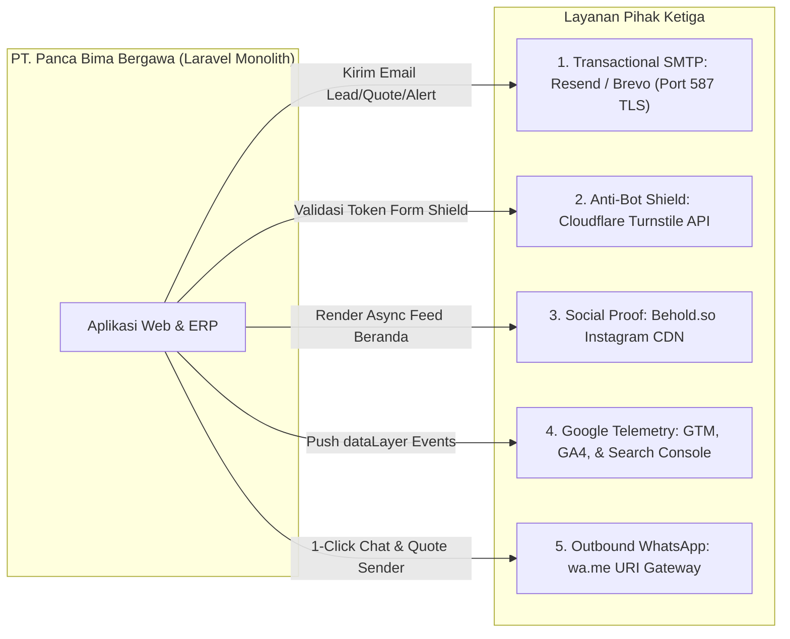

# 01. Topologi Domain & Lingkungan Infrastruktur
## System Architecture Document (SAD)

| Parameter Dokumen | Keterangan Formal |
| :--- | :--- |
| **Nama Proyek** | B2B Multi-Brand Product Showcase & Internal Commercial ERP |
| **Entitas Perusahaan** | **PT. Panca Bima Bergawa** (Disingkat: **PBB**) |
| **Alamat Kantor Pusat** | Gd. Wirausaha lt.1 Unit 104, Jl. H.R. Rasuna Said Kav. C5, Setiabudi, Jakarta Selatan 12920 |
| **Nomor Dokumen** | `DOC-PBB-SAD-01` |
| **Versi Dokumen** | 1.3.0 |
| **Tanggal Efektif** | September 2026 |
| **Klasifikasi Akses** | Internal Confidential & Engineering Reference |

### Riwayat Revisi Dokumen (Document Version Control)

| Versi | Tanggal | Penulis / Peran | Status | Ringkasan Perubahan |
| :---: | :---: | :--- | :---: | :--- |
| `1.0.0` | 01 Sep 2026 | Infrastructure Engineer | Draf Awal | Topologi multi-subdomain pada single codebase Laravel |
| `1.1.0` | 03 Sep 2026 | Cloud Hosting Architect | Ditinjau | Penyesuaian batasan Hostinger Premium (LiteSpeed, PHP 8.2, NVMe) |
| `1.2.0` | 05 Sep 2026 | Principal System Architect | Disetujui | Validasi single MySQL database `bimabergawa` & isolasi Document Root |
| `1.3.0` | 05 Sep 2026 | Principal System Architect | Disetujui | Penyelarasan kepatuhan UU HPP PPN snapshot, toleransi pencarian SKU, & eliminasi total emoji |

---

## 1. Blueprint Topologi Domain & Subdomain

Sistem beroperasi di bawah skema **Single Codebase, Multi-Domain Routing** di mana domain publik dan subdomain internal berbagi *document root* web server yang sama namun diarahkan ke alur logika terisolasi melalui Laravel Router:

```
                                    [ DNS HOSTINGER / CLOUDFLARE ]
                                                  │
                 ┌────────────────────────────────┴────────────────────────────────┐
                 ▼                                                                 ▼
   https://domain.com (Apex Domain)                              https://app.domain.com (Subdomain ERP)
 ┌──────────────────────────────────────────────┐                ┌──────────────────────────────────────────────┐
 │             WEB PUBLIK B2B                   │                │          INTERNAL COMMERCIAL ERP             │
 ├──────────────────────────────────────────────┤                ├──────────────────────────────────────────────┤
 │ • Document Root: .../public_html/public      │                │ • Document Root: .../public_html/public      │
 │ • Entry Point: routes/web.php                │                │ • Entry Point: app/Providers/Filament/...    │
 │ • Header: index, follow (SEO Dominance)      │                │ • Header: X-Robots-Tag: noindex, nofollow    │
 │ • Public SSL TLS 1.3                         │                │ • Internal Encrypted SSL TLS 1.3             │
 └──────────────────────────────────────────────┘                └──────────────────────────────────────────────┘
```

### Konfigurasi Routing Subdomain di Laravel:
Pemisahan rute dilakukan secara elegan di `routes/web.php` dan `app/Providers/Filament/AdminPanelProvider.php`:

```php
// Routing Panel Internal ERP pada Subdomain app.domain.com
// Dikonfigurasi langsung pada AdminPanelProvider
$panel
    ->default()
    ->id('admin')
    ->path('')
    ->domain(config('app.admin_domain', 'app.domain.com'))
    ->login()
    ...

// Routing Web Publik pada Apex Domain
Route::domain(config('app.public_domain', 'domain.com'))->group(function () {
    Route::get('/', [HomeController::class, 'index'])->name('home');
    Route::get('/catalog', [CatalogController::class, 'index'])->name('catalog.index');
    Route::get('/catalog/{slug}', [CatalogController::class, 'show'])->name('catalog.show');
    Route::get('/brand/{slug}', [BrandHubController::class, 'show'])->name('brand.hub');
    Route::get('/category/{slug}', [CategoryHubController::class, 'show'])->name('category.hub');
    Route::get('/compare', [ProductComparisonController::class, 'index'])->name('product.compare');
    Route::get('/rfq', [RfqCartController::class, 'index'])->name('rfq.index');
    Route::post('/rfq/submit', [RfqCartController::class, 'submit'])->name('rfq.submit');
    Route::get('/lacak-rfq', [OrderTrackingController::class, 'index'])->name('order.track');
    Route::get('/gabung-mitra', [PartnerRegistrationController::class, 'create'])->name('partner.register');
    Route::post('/gabung-mitra', [PartnerRegistrationController::class, 'store'])->name('partner.store');
});
```

---

## 2. Parameter Infrastruktur Hostinger Premium Web Hosting

Aplikasi dirancang khusus untuk mematuhi dan memaksimalkan parameter lingkungan **Hostinger Premium Web Hosting**:

| Komponen Infrastruktur | Karakteristik Hostinger Premium | Solusi Rekayasa Sistem (Laravel Engineering) |
|:---|:---|:---|
| **Web Server Engine** | LiteSpeed Web Server Enterprise | Optimasi `.htaccess` rewrite rules, kompresi Gzip/Brotli, dan dukungan HTTP/2 & HTTP/3. |
| **PHP Runtime** | PHP 8.2+ (OPcache Enabled) | Monolith ramping, autoload class optimization (`composer install --optimize-autoloader --no-dev`). |
| **Alokasi Memori (RAM)** | 512 MB per proses | Import Excel massal diproses per *chunk* 100 baris; keranjang penawaran dikelola di *localStorage* klien. |
| **Batas Waktu Eksekusi** | Max Execution Time 60–120 detik | Background processing non-blocking; tidak ada proses sinkronus berdurasi panjang. |
| **Ketiadaan Daemon/Supervisor** | Proses worker permanen akan di-kill OS | Eksekusi antrean via **Laravel Scheduler Cron hPanel per menit**: `queue:work --stop-when-empty --max-time=50`. |
| **Penyimpanan & Inodes** | Kuota inodes dan ruang SSD terbagi | Otomasi konversi semua upload ke **format WebP (maks 1200px, kualitas 85%)** via Intervention Image (hemat disk ~70%). |
| **Database Server** | MySQL 8.0 (InnoDB Engine, Max Conn ~50) | Transaksi atomik terindeks rapi, query eager-loading (`with()`) untuk mencegah masalah $N+1$, dan concurrency lock generator. |
| **Pengiriman Email** | SMTP lokal shared IP rentan masuk spam | Wajib integrasi **SMTP Transaksional Pihak Ketiga** (Resend / Brevo / Mailgun) via Port 587 TLS. |

---

## 3. Topologi Alur Eksekusi Cron Job Scheduler

```mermaid
graph TD
    A["hPanel Cron Job (* * * * *)"] -->|php artisan schedule:run| B["Laravel Kernel / Scheduler"]
    
    subgraph Periodic_Tasks ["Tugas Terjadwal Otomatis"]
        B -->|Setiap Menit| C["queue:work --stop-when-empty --max-time=50"]
        B -->|Harian Pukul 08:00| D["Command: CheckExpiringQuotations & CheckStaleLeads"]
        B -->|Bulanan (Tgl 1 Pukul 01:00)| E["Command: MonthlyDatabaseBackup (.sql.gz)"]
    end

    C -->|Kirim Email Transaksional| F["SMTP Eksternal (Resend / Brevo)"]
    C -->|Proses Batch Excel / DomPDF| G["Internal Queue Worker"]
    D -->|Kirim Alert / Notifikasi| H["Email Prospek & Email Direksi"]
    E -->|Arsip Terkompresi DB| I["storage/app/backups/ & Cloud Sync"]
```

### Konfigurasi Baris Perintah Cron Job di hPanel:
```bash
cd /home/uXXXXX/domains/domain.com/public_html && php artisan schedule:run >> /dev/null 2>&1
```

---

## 4. Konfigurasi Driver Internal Laravel (LiteSpeed Friendly)

Untuk menjamin reliabilitas dan konsistensi data di lingkungan Hostinger Premium Web Hosting:

| Tipe Driver | Driver Terpilih | Justifikasi & Mekanisme Teknis |
|:---|:---|:---|
| **Session Driver** | `database` (tabel `sessions`) | Menjaga persistensi sesi login OTP pengguna secara konsisten antar-permintaan HTTP tanpa bergantung pada filesystem hosting. |
| **Cache Driver** | `file` (direktori `storage/framework/cache`) | Menyimpan cache rute, konfigurasi, dan token verifikasi tanpa membutuhkan layanan Redis eksternal. |
| **Queue Connection** | `database` (tabel `jobs`) | Menampung antrean pengiriman email dan proses batch yang dieksekusi per menit oleh Cron Scheduler hPanel. |
| **Filesystem Disk** | `local` & `public` (`storage/app/public`) | Menyimpan brosur datasheet, foto WebP produk, dan berkas PDF penawaran/surat jalan resmi. |

---

## 5. Peta Integrasi Layanan Eksternal (Third-Party Boundary Architecture)



---

## 6. Pipeline Aset Terkompilasi & Static Cache Delivery

1. **Kompilasi Frontend (Build Step):**
   - Tailwind CSS dan pustaka JavaScript Alpine.js dikompilasi secara lokal atau via GitHub Actions CI pipeline (`npm run build`).
   - Berkas statis teroptimasi di `public/build/` diunggah ke server tanpa membutuhkan runtime Node.js aktif di server hosting.
2. **Pengelolaan Media & Storage Symlink:**
   - Direktori `storage/app/public` ditautkan ke `public/storage` melalui perintah `php artisan storage:link`.
   - File brosur PDF dan foto WebP dilayani langsung oleh web server LiteSpeed secara instan (*0 PHP engine execution time*).
