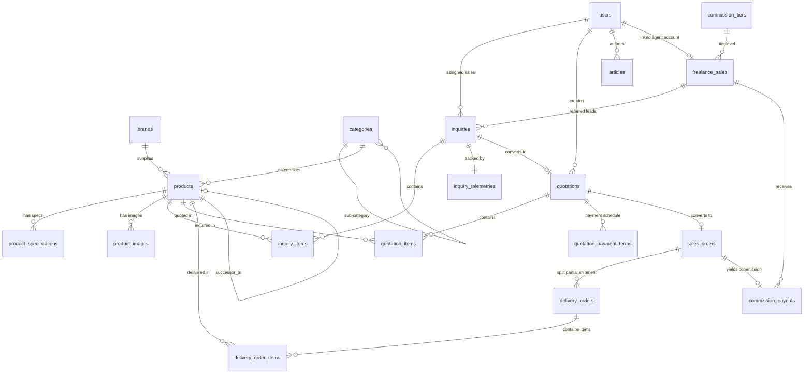

# 02. Struktur Aplikasi & Lapisan Komponen
## System Architecture Document (SAD)

| Parameter Dokumen | Keterangan Formal |
| :--- | :--- |
| **Nama Proyek** | B2B Multi-Brand Product Showcase & Internal Commercial ERP |
| **Entitas Perusahaan** | **PT. Panca Bima Bergawa** (Disingkat: **PBB**) |
| **Alamat Kantor Pusat** | Gd. Wirausaha lt.1 Unit 104, Jl. H.R. Rasuna Said Kav. C5, Setiabudi, Jakarta Selatan 12920 |
| **Nomor Dokumen** | `DOC-PBB-SAD-02` |
| **Versi Dokumen** | 1.3.0 |
| **Tanggal Efektif** | September 2026 |
| **Klasifikasi Akses** | Internal Confidential & Engineering Reference |

### Riwayat Revisi Dokumen (Document Version Control)

| Versi | Tanggal | Penulis / Peran | Status | Ringkasan Perubahan |
| :---: | :---: | :--- | :---: | :--- |
| `1.0.0` | 01 Sep 2026 | Software Architect | Draf Awal | Struktur folder Laravel 11, Service Layer, & Filament Panel Provider |
| `1.1.0` | 03 Sep 2026 | Lead Backend Engineer | Ditinjau | Penambahan struktur Service Layer (`DocumentNumberService`, `LiveMarginCalculator`) |
| `1.2.0` | 05 Sep 2026 | Principal System Architect | Disetujui | Pemisahan Service Domain & integrasi listener event komersial |
| `1.3.0` | 05 Sep 2026 | Principal System Architect | Disetujui | Penyelarasan kepatuhan UU HPP PPN snapshot, toleransi pencarian SKU, & eliminasi total emoji |

---

## 1. Lapisan Arsitektur Monolit Modular (Layered Architecture)

Aplikasi mengadopsi pola 4 lapis (*Four-Tier Architecture Pattern*) yang memisahkan tanggung jawab secara tegas (*Separation of Concerns*):

```
+─────────────────────────────────────────────────────────────────────────────+
|                        LAPISAN ARSITEKTUR APLIKASI                          |
+─────────────────────────────────────────────────────────────────────────────+

 1. PRESENTATION LAYER
    ├── Public Frontend: Blade Templates + Alpine.js + Tailwind CSS
    └── Internal ERP Panel: Filament Admin Panel (Livewire 3 Components)

 2. HTTP & ROUTING LAYER
    ├── Public Controllers (Catalog, Comparison, RFQ, Tracking, Compro)
    ├── Filament Resource Classes & Pages (CRUD, Kanban, PDF Actions)
    └── Security & Telemetry Middlewares (UTM, Ref Cookie, Anti-Spam, Throttle)

 3. SERVICE & DOMAIN BUSINESS LAYER
    ├── DocumentNumberService (Concurrency-Safe Lock Generator)
    ├── PricingAndMarginCalculatorService (DPP, PPN 11%, Margin HPP, Komisi)
    ├── DomPdfService (Watermarked Quotation & Clean Delivery Order)
    ├── TelemetryService (UTM Attributions & 90-Day Referral Cookie)
    ├── ImageOptimizationService (Resize 1200px & WebP Pipeline)
    ├── ExcelBulkService (Maatwebsite Chunking 100 Rows)
    └── NotificationEscalationService (Multi-Channel Dispatcher)

 4. PERSISTENCE & INFRASTRUCTURE LAYER
    ├── Eloquent ORM Models (Brands, Products, Inquiries, Quotes, Orders, etc.)
    ├── Global Tenant Scopes (Freelance Sales Isolation)
    ├── Database Migrations & Indexes (MySQL 8.0 InnoDB)
    └── Local / Cloud File Storage (Storage Facade, DomPDF Output, DB Backups)
```

---

## 2. Peta Rinci Model Basis Data & Relasi Inti



---

## 3. Spesifikasi Service Layer & Kontrak Logika Bisnis

### 3.1 `DocumentNumberService` (Concurrency-Safe Document Generator)
Menjamin nomor registrasi dokumen terurut atomik tanpa risiko duplikasi saat terjadi *concurrent request* dari form publik:

```php
namespace App\Services;

use Illuminate\Support\Facades\DB;
use App\Models\Inquiry;
use App\Models\Quotation;
use App\Models\SalesOrder;
use App\Models\DeliveryOrder;

class DocumentNumberService
{
    public static function generateInquiryNumber(): string
    {
        return DB::transaction(function () {
            $prefix = 'RFQ-' . date('Ym') . '-';
            $last = Inquiry::where('inquiry_number', 'LIKE', "{$prefix}%")
                ->lockForUpdate()
                ->orderByDesc('id')
                ->first();

            $seq = $last ? (int) substr($last->inquiry_number, -4) + 1 : 1;
            return $prefix . str_pad($seq, 4, '0', STR_PAD_LEFT);
        });
    }

    public static function generateQuotationNumber(): string
    {
        return DB::transaction(function () {
            $prefix = 'QUO-' . date('Ym') . '-';
            $last = Quotation::where('quotation_number', 'LIKE', "{$prefix}%")
                ->lockForUpdate()
                ->orderByDesc('id')
                ->first();

            $seq = $last ? (int) substr($last->quotation_number, -4) + 1 : 1;
            return $prefix . str_pad($seq, 4, '0', STR_PAD_LEFT);
        });
    }

    public static function generateSalesOrderNumber(): string
    {
        return DB::transaction(function () {
            $prefix = 'SO-' . date('Ym') . '-';
            $last = SalesOrder::where('order_number', 'LIKE', "{$prefix}%")
                ->lockForUpdate()
                ->orderByDesc('id')
                ->first();

            $seq = $last ? (int) substr($last->order_number, -4) + 1 : 1;
            return $prefix . str_pad($seq, 4, '0', STR_PAD_LEFT);
        });
    }

    public static function generateDeliveryOrderNumber(string $soNumber, int $partialIndex = 1): string
    {
        $cleanSo = str_replace('SO-', 'DO-', $soNumber);
        return $cleanSo . '/' . str_pad($partialIndex, 2, '0', STR_PAD_LEFT);
    }
}
```

### 3.2 `PricingAndMarginCalculatorService`
Menangani seluruh kalkulasi komersial, Dasar Pengenaan Pajak (DPP), PPN 11%, margin HPP internal, dan komisi agen:

```php
namespace App\Services;

class PricingAndMarginCalculatorService
{
    public static function calculateQuotationTotals(array $items, float $discountAmount = 0.0, float $commissionRate = 0.0): array
    {
        $subtotal = 0.0;
        $totalCost = 0.0;

        foreach ($items as $item) {
            $qty = (int) ($item['quantity'] ?? 1);
            $unitPrice = (float) ($item['unit_price'] ?? 0);
            $costPrice = (float) ($item['cost_price'] ?? 0);

            $subtotal += ($qty * $unitPrice);
            $totalCost += ($qty * $costPrice);
        }

        $dpp = max(0.0, $subtotal - $discountAmount);
        $taxAmount = round($dpp * 0.11, 2); // UU HPP PPN 11%
        $grandTotal = $dpp + $taxAmount;

        // Gross Profit Margin %
        $grossProfit = $dpp - $totalCost;
        $marginPercentage = $dpp > 0 ? round(($grossProfit / $dpp) * 100, 2) : 0.0;
        $requiresDirectorApproval = ($marginPercentage < 15.0) || ($discountAmount > ($subtotal * 0.10));

        // Komisi Freelance
        $commissionAmount = round($dpp * ($commissionRate / 100), 2);

        return [
            'subtotal' => $subtotal,
            'discount_amount' => $discountAmount,
            'dpp' => $dpp,
            'tax_amount' => $taxAmount,
            'grand_total' => $grandTotal,
            'total_cost' => $totalCost,
            'gross_profit' => $grossProfit,
            'margin_percentage' => $marginPercentage,
            'requires_director_approval' => $requiresDirectorApproval,
            'commission_amount' => $commissionAmount,
        ];
    }
}
```

---

## 4. Struktur Antarmuka & Resource Panel ERP (Filament TALL Stack)

Panel internal diorganisasi ke dalam grup navigasi intuitif di `app/Filament/Resources`:

```
Filament Navigation Menu:
├── [Dashboard & Telemetri]
│   └── Dashboard (Metrik Omzet, Funnel Pipeline, Channel Attribution, Agent Leaderboard)
├── [Master Produk & Katalog]
│   ├── BrandResource (Prinsipal Resmi, Logo WebP, Status)
│   ├── CategoryResource (Pohon Hierarki Parent-Child)
│   ├── ProductResource (Multi-tab Spek, Foto, Brosur PDF, HPP, Suksesor)
│   └── ImportCatalogResource (Engine Excel Batch 100 Baris)
├── [Transaksi Komersial & CRM]
│   ├── InquiryResource (Kanban Board Leads, Telemetri UTM, Stale Alert)
│   ├── QuotationResource (Quote Builder, Live Margin, Skema Pembayaran, DomPDF)
│   └── SalesOrderResource (PO Locking, Partial Delivery Order Ekspedisi)
├── [Program Kemitraan Freelance]
│   ├── PartnerApplicationResource (Screening KTP, Sektor Industri & Approval)
│   ├── CommissionTierResource (Konfigurasi Mandiri Single/Multi-Tier)
│   └── CommissionPayoutResource (Rekap Tagihan Komisi & Upload Slip Transfer)
├── [CMS Publik & Komunikasi]
│   ├── ArticleResource (Wawasan & Berita, Kategori, SEO)
│   ├── ContactMessageResource (Inbox Pesan Masuk Web)
│   └── SiteSettingResource (CMS 100% Konten Compro, Medsos, Banner, Legal TnC)
└── [Pengaturan Sistem & Keamanan]
    ├── UserResource (Spatie RBAC: Super Admin, Sales, Marketing, Freelance)
    └── ActivitylogResource (Audit Trail Finansial & Otorisasi Direksi)
```
