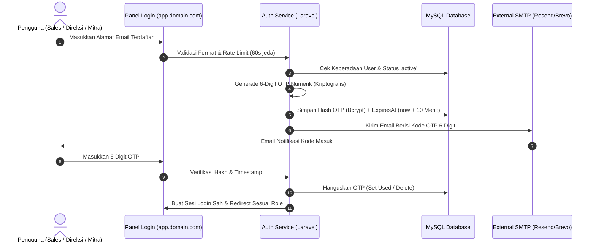

# 03. Keamanan, Isolasi Subdomain & Autentikasi
## System Architecture Document (SAD)

| Parameter Dokumen | Keterangan Formal |
| :--- | :--- |
| **Nama Proyek** | B2B Multi-Brand Product Showcase & Internal Commercial ERP |
| **Entitas Perusahaan** | **PT. Panca Bima Bergawa** (Disingkat: **PBB**) |
| **Alamat Kantor Pusat** | Gd. Wirausaha lt.1 Unit 104, Jl. H.R. Rasuna Said Kav. C5, Setiabudi, Jakarta Selatan 12920 |
| **Nomor Dokumen** | `DOC-PBB-SAD-03` |
| **Versi Dokumen** | 1.3.0 |
| **Tanggal Efektif** | September 2026 |
| **Klasifikasi Akses** | Internal Confidential & Engineering Reference |

### Riwayat Revisi Dokumen (Document Version Control)

| Versi | Tanggal | Penulis / Peran | Status | Ringkasan Perubahan |
| :---: | :---: | :--- | :---: | :--- |
| `1.0.0` | 01 Sep 2026 | Security & IAM Architect | Draf Awal | Desain RBAC Spatie, Passwordless Email OTP, & anti-indexing header |
| `1.1.0` | 03 Sep 2026 | AppSec Engineer | Ditinjau | Penambahan proteksi HPP level ORM query & sanitasi upload PDF/WebP |
| `1.2.0` | 05 Sep 2026 | Principal System Architect | Disetujui | Desain isolasi tenant Eloquent Global Scope untuk Portal Freelance |
| `1.3.0` | 05 Sep 2026 | Principal System Architect | Disetujui | Penyelarasan kepatuhan UU HPP PPN snapshot, toleransi pencarian SKU, & eliminasi total emoji |

---

## 1. Arsitektur Isolasi Subdomain & Anti-Indexing

Sistem memisahkan secara ketat batas akses publik dan antarmuka operasional internal perusahaan:

```
                                    [ REQUEST MASUK ]
                                           │
                  ┌────────────────────────┴────────────────────────┐
                  ▼                                                 ▼
       [ Host: domain.com ]                              [ Host: app.domain.com ]
                  │                                                 │
                  ▼                                                 ▼
     ┌────────────────────────┐                        ┌────────────────────────┐
     │  ZONA AKSES PUBLIK     │                        │  ZONA AKSES INTERNAL   │
     │                        │                        │                        │
     │ • Indexable oleh Google│                        │ • Header X-Robots-Tag: │
     │ • Form Shield Terpadu  │                        │   noindex, nofollow    │
     │ • 100% Tanpa Harga     │                        │ • Wajib Sesi OTP Valid │
     │ • Cookie Ref 90 Hari   │                        │ • Spatie RBAC Guard    │
     └────────────────────────┘                        └────────────────────────┘
```

### Implementasi Middleware Header Anti-Indexing:
```php
namespace App\Http\Middleware;

use Closure;
use Illuminate\Http\Request;
use Symfony\Component\HttpFoundation\Response;

class IsolateAdminSubdomain
{
    public function handle(Request $request, Closure $next): Response
    {
        $response = $next($request);

        if ($request->getHost() === config('app.admin_domain', 'app.domain.com')) {
            $response->headers->set('X-Robots-Tag', 'noindex, nofollow, noarchive, nosnippet');
            $response->headers->set('X-Frame-Options', 'DENY');
            $response->headers->set('X-Content-Type-Options', 'nosniff');
        }

        return $response;
    }
}
```

---

## 2. Sistem Autentikasi Masuk Panel: Passwordless Email OTP

Untuk menghilangkan risiko kebocoran kata sandi statis dan menjamin kepatuhan keamanan:



### Parameter Keamanan OTP:
- **Masa Berlaku:** 10 Menit kalender.
- **Toleransi Percobaan:** Maksimal 3 kali kesalahan input per kode sebelum OTP dihanguskan.
- **Rate Limiting:** Jeda minimal 60 detik antar permintaan kirim ulang OTP.

---

## 3. Matriks Kontrol Hak Akses Berbasis Peran (Spatie RBAC Matrix)

| Fitur / Modul ERP | Super Admin / Direksi | Sales Representative | Freelance Sales Agent | Content Marketing |
|:---|:---:|:---:|:---:|:---:|
| **Dashboard Metrik Finansial & Omzet** | **Penuh (Semua)** | Khusus Pribadi | Khusus Pribadi | Terbatas (Traffic Only) |
| **Master Produk & Katalog** | **Penuh (CRUD)** | View Only | View Only | **Penuh (CRUD + Import)** |
| **Lihat Nilai HPP (Cost Price Modal)**| **Ya (Semua)** | **Ya** | **TIDAK (Tersembunyi)** | **TIDAK** |
| **CRM Leads / Inquiry Masuk** | **Penuh (Semua)** | Prospek Terdisposisi | **Hanya Milik Sendiri** | Tidak Ada Akses |
| **Approval Diskon > 10% & Margin < 15%**| **Akses Tunggal** | Tidak Ada Akses | Tidak Ada Akses | Tidak Ada Akses |
| **Buat & Terbitkan Quotation PDF** | **Penuh** | **Penuh** | Tidak (Draft Only) | Tidak Ada Akses |
| **Terbitkan Sales Order & Partial DO** | **Penuh** | **Penuh** | View Status Only | Tidak Ada Akses |
| **Approval Pendaftaran Mitra Kemitraan**| **Akses Tunggal** | View Only | Tidak Ada Akses | Tidak Ada Akses |
| **Konfigurasi Tiering Komisi Mandiri** | **Akses Tunggal** | Tidak Ada Akses | Tidak Ada Akses | Tidak Ada Akses |
| **Otorisasi & Upload Bukti Payout Komisi**| **Akses Tunggal**| Tidak Ada Akses | Download Bukti Milik Sendiri | Tidak Ada Akses |
| **CMS Konten Compro, Banner & Medsos**| **Penuh** | View Only | View Only | **Penuh** |
| **Pencadangan Database & Log Audit** | **Akses Tunggal** | Tidak Ada Akses | Tidak Ada Akses | Tidak Ada Akses |

---

## 4. Arsitektur Portal Freelance & Isolasi Data (*Multi-Tenant Global Scope*)

Meskipun staf internal kantor dan mitra freelance sales mengakses URL yang sama di **`https://app.domain.com`**, sistem menyajikan antarmuka dan kontrol data yang terpisah secara tegas:

```
                                [ LOGIN KE app.domain.com ]
                                             │
                      ┌──────────────────────┴──────────────────────┐
                      ▼                                             ▼
       [ LOGIN: SUPER ADMIN / SALES INTERNAL ]       [ LOGIN: MITRA FREELANCE SALES ]
 ┌───────────────────────────────────────────┐ ┌───────────────────────────────────────────┐
 │       PANEL OPERASIONAL LENGKAP           │ │       PORTAL MANDIRI FREELANCE AGENT      │
 ├───────────────────────────────────────────┤ ├───────────────────────────────────────────┤
 │ • Dashboard Omzet & Keuangan Global       │ │ • Dashboard Performa Pribadi Saya         │
 │ • Master Produk (Input HPP Modal & Spek)  │ │ • Simulator Hitung Komisi Interaktif      │
 │ • Seluruh Leads Prospek Masuk (Kanban)    │ │ • Input Prospek Lapangan Mandiri          │
 │ • Otorisasi Diskon Khusus Direksi         │ │ • Generator Link Referal + Teks Share WA  │
 │ • Buat Quotation, SO & Delivery Order     │ │ • Pantau Status Pesanan yang Dirujuk      │
 │ • Verifikasi Mitra & Konfigurasi Tiering  │ │ • Rekap Komisi & Download Slip Transfer   │
 │ • CMS Dynamic Website & Pengaturan Compro │ │                                           │
 │ • Log Audit & Backup Database             │ │ [BLOCKED] TIDAK BISA LIHAT: HPP Modal, User Lain,│
 │                                           │ │    CMS Web, Log Finansial Perusahaan      │
 └───────────────────────────────────────────┘ └───────────────────────────────────────────┘
```

Mitra freelance sales beroperasi di bawah prinsip **Zero-Cross Access**. Model Eloquent utama menyematkan *Global Scope* otomatis:

```php
namespace App\Models;

use Illuminate\Database\Eloquent\Model;
use Illuminate\Database\Eloquent\Builder;

class Quotation extends Model
{
    protected static function booted(): void
    {
        static::addGlobalScope('freelance_tenant_isolation', function (Builder $builder) {
            if (auth()->check() && auth()->user()->hasRole('freelance_sales')) {
                $builder->where('freelance_sales_id', auth()->user()->freelance_sales_id);
            }
        });
    }
}
```

---

## 5. Sistem Proteksi Formulir Publik (*Multi-Layer Anti-Spam Shield*)

Seluruh formulir publik (Single RFQ, Bulk Cart, Kontak Compro, Registrasi Mitra) dilindungi oleh 4 lapis filter:

```
[ SUBMISSION FORMULIR PUBLIK ]
              │
              ▼
 1. Invisible Honeypot Field    --> Bot mengisi field jebakan? -> Batalkan diam-diam (HTTP 200 Fake).
              │
              ▼
 2. Submission Time-Trap        --> Waktu submit < 2 detik sejak render? -> Tolak bot instan.
              │
              ▼
 3. Cloudflare Turnstile        --> Validasi token non-intrusif via Cloudflare API.
              │
              ▼
 4. IP Throttle Middleware      --> Maksimal 5 pengiriman per menit per IP address.
              │
              ▼
 [ SIMPAN KE BASIS DATA ]
```

---

## 6. Kepatuhan Hukum & Perlindungan Data Pribadi (UU PDP)

1. **Enkripsi Data Sensitif:** Nomor Induk Kependudukan (NIK 16 digit) dan nomor rekening bank mitra freelance dienkripsi pada tingkat database (`casts => 'encrypted'`).
2. **Kerahasiaan Kontak Klien B2B:** Nomor WhatsApp dan email klien pemohon RFQ diisolasi di basis data internal dan tidak pernah terekspos ke antarmuka publik atau log sistem terbuka.
3. **Penyimpanan Berkas Legalitas:** Berkas foto KTP calon agen dan lampiran BoQ proyek disimpan di direktori privat yang dilindungi *storage policy* terotorisasi.
