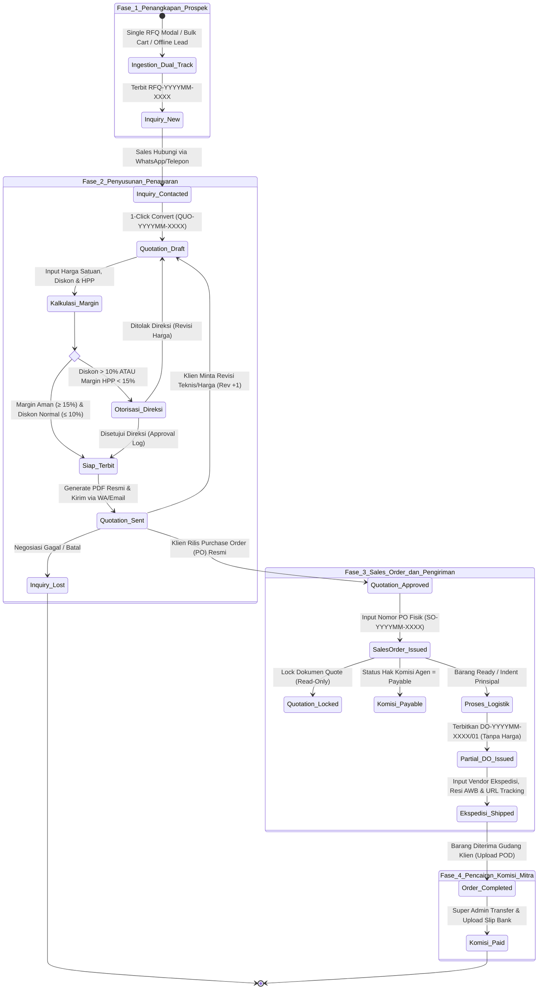
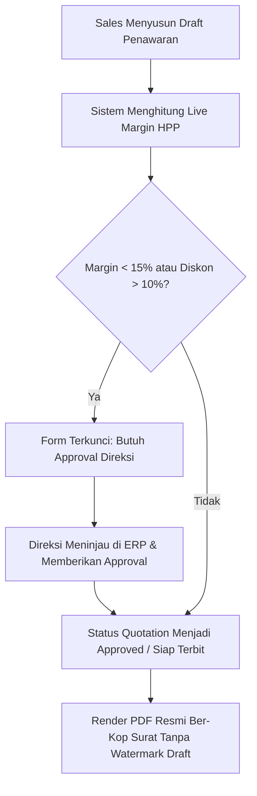

# 04. State Machine Alur Komersial & Pipeline Dokumen
## System Architecture Document (SAD)

| Parameter Dokumen | Keterangan Formal |
| :--- | :--- |
| **Nama Proyek** | B2B Multi-Brand Product Showcase & Internal Commercial ERP |
| **Entitas Perusahaan** | **PT. Panca Bima Bergawa** (Disingkat: **PBB**) |
| **Alamat Kantor Pusat** | Gd. Wirausaha lt.1 Unit 104, Jl. H.R. Rasuna Said Kav. C5, Setiabudi, Jakarta Selatan 12920 |
| **Nomor Dokumen** | `DOC-PBB-SAD-04` |
| **Versi Dokumen** | 1.3.0 |
| **Tanggal Efektif** | September 2026 |
| **Klasifikasi Akses** | Internal Confidential & Engineering Reference |

### Riwayat Revisi Dokumen (Document Version Control)

| Versi | Tanggal | Penulis / Peran | Status | Ringkasan Perubahan |
| :---: | :---: | :--- | :---: | :--- |
| `1.0.0` | 01 Sep 2026 | Enterprise Architect | Draf Awal | Definisi diagram state machine Inquiry -> Quotation -> SO -> DO |
| `1.1.0` | 03 Sep 2026 | Commercial Systems Engineer | Ditinjau | Penambahan state partial fulfillment pada Delivery Order (Surat Jalan) |
| `1.2.0` | 05 Sep 2026 | Principal System Architect | Disetujui | Validasi transisi status otomatis & trigger webhooks notifikasi email |
| `1.3.0` | 05 Sep 2026 | Principal System Architect | Disetujui | Penyelarasan kepatuhan UU HPP PPN snapshot, toleransi pencarian SKU, & eliminasi total emoji |

---

## 1. Diagram State Machine Alur Komersial Menyeluruh

Sistem mengelola siklus hidup transaksi B2B dari tahap penangkapan prospek hingga penyelesaian pengiriman barang dan pencairan komisi:



---

## 2. Kalkulator Margin Laba HPP & Otorisasi Direksi

Untuk menjaga kesehatan finansial perusahaan dari risiko perang harga dan fluktuasi kurs prinsipal:

$$\text{DPP} = \text{Subtotal} - \text{Diskon}$$
$$\text{Total HPP (Modal)} = \sum (\text{cost\_price} \times \text{kuantiti})$$
$$\text{Gross Profit Margin \%} = \frac{\text{DPP} - \text{Total HPP}}{\text{DPP}} \times 100\%$$



---

## 3. Mesin Skema Pembayaran Fleksibel (*Flexible Payment Terms Engine*)

Sistem mendukung fleksibilitas penuh untuk transaksi langsung maupun proyek bertahap:

```
                                  [ PILIHAN SKEMA PEMBAYARAN ]
                                                │
                ┌───────────────────────────────┴───────────────────────────────┐
                ▼                                                               ▼
    [ TIPE A: PEMBAYARAN LANGSUNG 100% ]                         [ TIPE B: TERMIN / PER FASE / BERTAHAP ]
                │                                                               │
  ┌─────────────┼─────────────┐                                   ┌─────────────┼─────────────┐
  ▼             ▼             ▼                                   ▼             ▼             ▼
[ 100% CBD ]  [ 100% COD ]  [ 100% TOP Net X ]                  [ 2 Fase ]    [ 3 Fase ]    [ Custom N-Fase ]
(Bayar Lunas  (Bayar Lunas  (Bayar Lunas Net 14/                (DP 50% +     (DP 30% +     (Admin bebas
 di Awal       saat Barang   30/60 Hari setelah                  Pelunasan     50% Kirim +   mengatur berapa pun
 sebelum       Tiba di       Barang & Invoice                    sebelum       20% Retensi   fase & persentase,
 Kirim/Indent) Gudang)       Diterima)                           Kirim)        Komisioning)  total = 100%)
```

### Validasi Integritas Termin:
Jika memilih Tipe B (Multi-Termin), sistem menjalankan validasi:
$$\sum_{i=1}^{N} \text{percentage}_i = 100.00\%$$

---

## 4. Mesin Dokumen PDF Ber-Watermark Dinamis (*DomPDF Layer*)

Generator PDF (`Barryvdh\DomPDF\Facade\Pdf`) menyematkan lapisan keamanan visual otomatis:

| Status Dokumen | Tampilan Watermark Diagonal | Elemen Kop Surat & Tanda Tangan | Kegunaan Bisnis |
|:---|:---|:---|:---|
| `draft` | **"DRAFT - NOT OFFICIAL"** (Opasitas 15%) | Tanpa tanda tangan PIC | Mencegah draf diedit disalahgunakan sebelum disetujui internal. |
| `sent` / `approved` | **BERSIH (Tanpa Watermark)** | Kop Surat Resmi, TTD Digital & Rekening Bank | Berkas penawaran resmi berkuasa hukum yang dikirim ke klien. |
| `expired` | **"EXPIRED / VOID"** (Merah Pudar) | Dicap kedaluwarsa | Menghindari klaim harga lama saat kurs mata uang telah berubah. |

---

## 5. Arsitektur Surat Jalan Ekspedisi & Partial Delivery Order

```
[ SALES ORDER (SO-202609-0012) ] - Total: 15 Unit Pompa Ebara
                      │
       ┌──────────────┴──────────────┐
       ▼                             ▼
[ PENGIRIMAN TAHAP 1 ]         [ PENGIRIMAN TAHAP 2 ]
DO-202609-0012/01 (10 Unit)    DO-202609-0012/02 (5 Unit)
- Ekspedisi: Baraka Cargo      - Ekspedisi: Indah Logistik
- Resi: BRK-881290             - Resi: IND-992011
- Resi Tracking URL            - Resi Tracking URL
- 100% TANPA HARGA             - 100% TANPA HARGA
- Kolom Stempel Gudang Pabrik  - Kolom Stempel Gudang Pabrik
```

1. **Privasi Finansial Mutlak:** Berkas PDF Surat Jalan dicetak murni memuat: *Nama Ekspedisi, Nomor Resi/AWB, Estimasi Koli & Berat, Rincian Barang/Model, Alamat Pabrik Tujuan, PIC Lapangan, Catatan Penanganan, dan Kolom Tanda Tangan/Stempel Gudang*.
2. **Pelacakan Publik (`/lacak-rfq`):** Calon pembeli/klien dapat memantau status pesanan dan menekan tombol *"Lacak di Website Resmi Ekspedisi"* untuk membuka portal cek resi kurir terkait secara instan.
