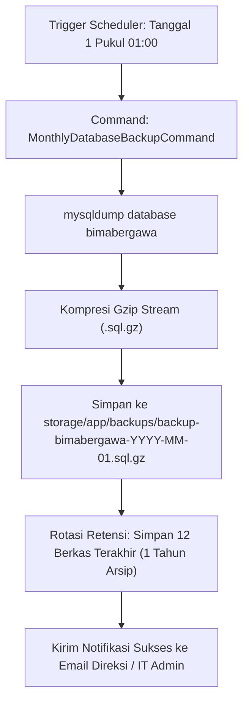
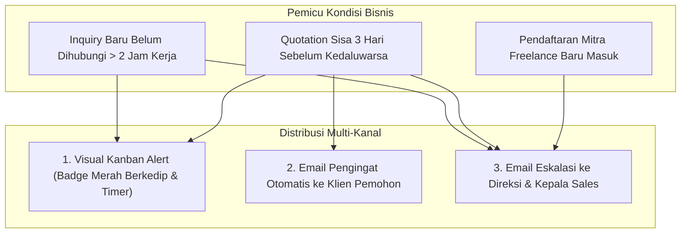

# 05. Otomasi Sistem, Pencadangan Bulanan & Notifikasi
## System Architecture Document (SAD)

| Parameter Dokumen | Keterangan Formal |
| :--- | :--- |
| **Nama Proyek** | B2B Multi-Brand Product Showcase & Internal Commercial ERP |
| **Entitas Perusahaan** | **PT. Panca Bima Bergawa** (Disingkat: **PBB**) |
| **Alamat Kantor Pusat** | Gd. Wirausaha lt.1 Unit 104, Jl. H.R. Rasuna Said Kav. C5, Setiabudi, Jakarta Selatan 12920 |
| **Nomor Dokumen** | `DOC-PBB-SAD-05` |
| **Versi Dokumen** | 1.3.0 |
| **Tanggal Efektif** | September 2026 |
| **Klasifikasi Akses** | Internal Confidential & Engineering Reference |

### Riwayat Revisi Dokumen (Document Version Control)

| Versi | Tanggal | Penulis / Peran | Status | Ringkasan Perubahan |
| :---: | :---: | :--- | :---: | :--- |
| `1.0.0` | 01 Sep 2026 | Reliability & DevOps Engineer | Draf Awal | Desain penjadwalan cron worker `queue:work` & email notifications |
| `1.1.0` | 03 Sep 2026 | Database Administrator | Ditinjau | Penambahan spesifikasi backup otomatis database bulanan `.sql.gz` |
| `1.2.0` | 05 Sep 2026 | Principal System Architect | Disetujui | Aturan trigger alert lead kadaluarsa (>2 jam) & eskalasi email direksi |
| `1.3.0` | 05 Sep 2026 | Principal System Architect | Disetujui | Penyelarasan kepatuhan UU HPP PPN snapshot, toleransi pencarian SKU, & eliminasi total emoji |

---

## 1. Topologi Penjadwalan Tugas Otomatis (Laravel Scheduler Engine)

Seluruh background job, pemeliharaan basis data, dan sistem pengingat otomatis dikendalikan melalui **Satu Baris Cron Job Induk di hPanel Hostinger**:

```bash
* * * * * cd /home/uXXXXX/domains/domain.com/public_html && php artisan schedule:run >> /dev/null 2>&1
```

### Definisi Jadwal Tugas di `app/Console/Kernel.php` / `routes/console.php`:
```php
use Illuminate\Support\Facades\Schedule;

// 1. Queue Worker: Berjalan tiap menit dengan batas durasi 50 detik
Schedule::command('queue:work --stop-when-empty --max-time=50')
    ->everyMinute()
    ->withoutOverlapping(2);

// 2. Notifikasi Harian: Cek Penawaran Mendekati Kedaluwarsa & Lead Menggantung
Schedule::command('crm:check-expiring-quotations')
    ->dailyAt('08:00')
    ->withoutOverlapping();

Schedule::command('crm:check-stale-leads')
    ->hourly()
    ->between('08:00', '18:00')
    ->withoutOverlapping();

// 3. Pencadangan Database: 1x Per Bulan (Tanggal 1 Pukul 01:00 Dini Hari)
Schedule::command('system:backup-database-monthly')
    ->monthlyOn(1, '01:00')
    ->withoutOverlapping();
```

---

## 2. Arsitektur Pencadangan Database Bulanan Terkompresi

Untuk menjamin keamanan aset data perusahaan tanpa membebani kuota inodes dan CPU server:



### Spesifikasi Berkas Backup:
- **Nama Berkas:** `backup-bimabergawa-YYYY-MM-01.sql.gz`
- **Format:** MySQL Raw SQL terkompresi Gzip (~80% reduksi ukuran berkas).
- **Akses Unduhan:** Disediakan tombol download berkas arsip langsung pada panel Super Admin ERP.

---

## 3. Mesin Notifikasi & Eskalasi Multi-Kanal (*Notification Engine*)



### 3.1 Peringatan Visual Kanban (*Stale Lead Alert*)
- Jika sebuah prospek berstatus `new` belum mengalami perubahan status atau belum dihubungi sales dalam waktu $> 2\text{ jam}$ kerja (Senin–Jumat, 08:00–17:00), kartu prospek pada Kanban board otomatis:
  - Berubah warna latar belakang menjadi merah muda berkedip (*subtle pulsing effect*).
  - Menampilkan badge timer *"Belum dihubungi: X jam Y menit"*.

### 3.2 Auto-Email Pengingat Santun ke Prospek (*Prospect Courtesy Reminder*)
- Pada H-3 sebelum tanggal masa berlaku penawaran (`quotation->expires_at`) berakhir, sistem mengirimkan email profesional otomatis:
  - *Subjek:* `[Pengingat] Masa Berlaku Penawaran Resmi PT. Panca Bima Bergawa (PBB) - QUO-YYYYMM-XXXX`
  - *Isi Pesan:* Menyapa PIC klien, mengingatkan nomor penawaran, melampirkan tautan download PDF resmi, dan menawarkan bantuan teknis jika ada pertanyaan lebih lanjut.

### 3.3 Email Eskalasi ke Direksi & Head of Sales
- **Eskalasi Lead Menggantung:** Memberikan visibilitas langsung kepada pimpinan jika ada prospek inbound yang terlambat ditindaklanjuti oleh tim komersial.
- **Rekapitulasi Penawaran Tertunda:** Mengirimkan ringkasan berkala atas penawaran bernilai besar yang mendekati jatuh tempo agar pimpinan dapat memberikan instruksi strategi negosiasi khusus kepada staf sales terkait.
