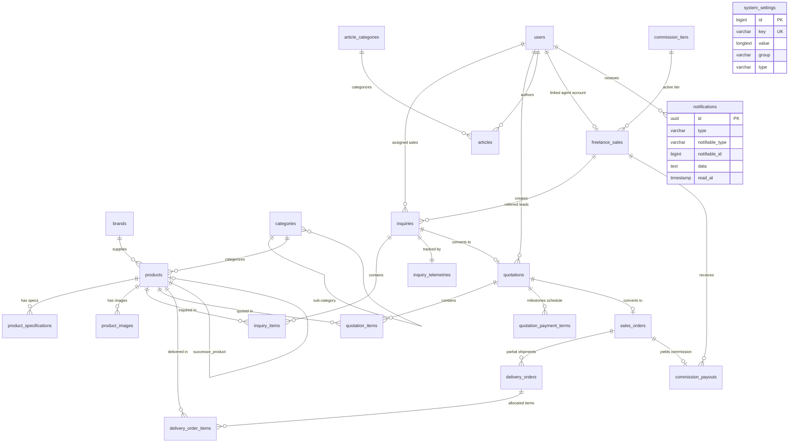

# System Technical Design Document (SDD) - Master Index
## Proyek: B2B Multi-Brand Product Showcase & Internal Commercial ERP

| Parameter Dokumen | Keterangan Formal |
| :--- | :--- |
| **Nama Proyek** | B2B Multi-Brand Product Showcase & Internal Commercial ERP |
| **Entitas Perusahaan** | **PT. Panca Bima Bergawa** (Disingkat: **PBB**) |
| **Alamat Kantor Pusat** | Gd. Wirausaha lt.1 Unit 104, Jl. H.R. Rasuna Said Kav. C5, Setiabudi, Jakarta Selatan 12920 |
| **Nomor Dokumen** | `DOC-PBB-SDD-IDX` |
| **Versi Dokumen** | 1.4.1 |
| **Tanggal Efektif** | September 2026 |
| **Klasifikasi Akses** | Internal Confidential & Engineering Reference |

### Riwayat Revisi Dokumen (Document Version Control)

| Versi | Tanggal | Penulis / Peran | Status | Ringkasan Perubahan |
| :---: | :---: | :--- | :---: | :--- |
| `1.0.0` | 01 Sep 2026 | Database & Software Engineer | Draf Awal | Desain skema DB MySQL 8.0, relasi Eloquent, & Service Layer |
| `1.1.0` | 03 Sep 2026 | Lead Backend Developer | Ditinjau | Penambahan service `LiveMarginCalculator` & skema tabel termin `quotation_payment_terms` |
| `1.2.0` | 05 Sep 2026 | Principal System Architect | Disetujui | Validasi integritas single DB `bimabergawa` & standarisasi dokumen |
| `1.3.0` | 05 Sep 2026 | Principal System Architect | Disetujui | Penyelarasan kepatuhan UU HPP PPN snapshot, toleransi pencarian SKU, & eliminasi total emoji |
| `1.4.0` | 06 Sep 2026 | Principal System Architect | Disetujui | Penambahan entitas `system_settings` untuk konfigurasi dinamis PPN & parameter operasional ERP |
| `1.4.1` | 06 Sep 2026 | Principal System Architect | Disetujui | Penambahan entitas `notifications` untuk arsitektur notifikasi multi-kanal (lonceng ERP & email) |

---

## 1. Ringkasan Eksekutif Desain Teknis (Technical Design Summary)

Dokumen **System Technical Design Document (SDD / TDD)** ini merupakan panduan teknis mendalam dan spesifikasi implementasi tingkat kode untuk pengembangan sistem **B2B Multi-Brand Product Showcase, Company Profile & Internal Commercial ERP (PT. Panca Bima Bergawa / PBB)**.

Dokumen ini mentranslasikan arsitektur monolit modular dari **SAD** ke dalam definisi teknis presisi: skema basis data relasional MySQL 8.0, strategi pengindeksan performa tinggi, kontrak relasi Eloquent ORM, logika *Service Layer*, spesifikasi resource panel *Filament Admin*, serta arsitektur state reaktif *Alpine.js* di sisi web publik.

---

## 2. Struktur Dokumen Modular SDD

Untuk memudahkan peninjauan teknis dan proses pemrograman terstruktur, SDD dipecah ke dalam 5 berkas spesifik:

```
docs/02-architecture-and-design/SDD/
├── README.md                                             # [Dokumen Saat Ini] Ringkasan Eksekutif & Master Index
├── 01-database-schema-and-indexing-design.md             # ERD Menyeluruh, Skema Tabel MySQL, Foreign Keys, & B-Tree Indexing
├── 02-eloquent-models-and-domain-entities.md             # Definisi Model Eloquent, Relasi, Casts, & Global Scope Tenant
├── 03-core-services-and-business-logic.md                # Layanan Bisnis Inti (Document Number, Margin HPP, DomPDF, Telemetry, WebP)
├── 04-filament-resources-and-ui-architecture.md          # Spesifikasi Filament Resource, Form Schema, Kanban CRM, & Custom Pages
└── 05-public-frontend-and-reactive-state.md              # Arsitektur Blade, State Alpine.js (RFQ Cart & Compare), & SEO Tags
```

---

## 3. Diagram Relasi Entitas Menyeluruh (Comprehensive Database ERD)



---

## 4. Matriks Keselarasan dengan Kebutuhan Sistem (BRD / PRD / SRS / SAD)

| Pilar Desain Teknis | Modul / Berkas SDD Terkait | Implementasi Teknis dalam Kode |
|:---|:---|:---|
| **Katalog 100% Tanpa Harga** | [01-database-schema-and-indexing-design.md](file:///e:/Project/bimabergawa/docs/02-architecture-and-design/SDD/01-database-schema-and-indexing-design.md), [05-public-frontend-and-reactive-state.md](file:///e:/Project/bimabergawa/docs/02-architecture-and-design/SDD/05-public-frontend-and-reactive-state.md) | Tidak ada kolom harga di tabel publik; form hanya menyimpan RFQ inquiry. |
| **Live Margin HPP & Approval** | [02-eloquent-models-and-domain-entities.md](file:///e:/Project/bimabergawa/docs/02-architecture-and-design/SDD/02-eloquent-models-and-domain-entities.md), [03-core-services-and-business-logic.md](file:///e:/Project/bimabergawa/docs/02-architecture-and-design/SDD/03-core-services-and-business-logic.md) | Kolom `cost_price` pada produk, `PricingAndMarginCalculatorService` menghitung laba kotor & gate approval $< 15\%$. |
| **Skema Pembayaran Fleksibel** | [01-database-schema-and-indexing-design.md](file:///e:/Project/bimabergawa/docs/02-architecture-and-design/SDD/01-database-schema-and-indexing-design.md), [04-filament-resources-and-ui-architecture.md](file:///e:/Project/bimabergawa/docs/02-architecture-and-design/SDD/04-filament-resources-and-ui-architecture.md) | Tabel `quotation_payment_terms` mendukung 100% CBD/COD/TOP & custom milestones ($N$-fase). |
| **Surat Jalan Ekspedisi (DO)** | [01-database-schema-and-indexing-design.md](file:///e:/Project/bimabergawa/docs/02-architecture-and-design/SDD/01-database-schema-and-indexing-design.md), [03-core-services-and-business-logic.md](file:///e:/Project/bimabergawa/docs/02-architecture-and-design/SDD/03-core-services-and-business-logic.md) | Tabel `delivery_orders` & `delivery_order_items` pengiriman bertahap tanpa kolom nominal harga. |
| **Tiering Komisi Agen** | [01-database-schema-and-indexing-design.md](file:///e:/Project/bimabergawa/docs/02-architecture-and-design/SDD/01-database-schema-and-indexing-design.md), [04-filament-resources-and-ui-architecture.md](file:///e:/Project/bimabergawa/docs/02-architecture-and-design/SDD/04-filament-resources-and-ui-architecture.md) | Tabel `commission_tiers` & `commission_payouts` dengan lampiran slip transfer bank. |
| **Pencadangan Bulanan** | [03-core-services-and-business-logic.md](file:///e:/Project/bimabergawa/docs/02-architecture-and-design/SDD/03-core-services-and-business-logic.md) | Command `MonthlyDatabaseBackupCommand` mengeksekusi dump `.sql.gz` otomatis tiap tanggal 1. |
| **Auto-Reminder Multi-Kanal** | [03-core-services-and-business-logic.md](file:///e:/Project/bimabergawa/docs/02-architecture-and-design/SDD/03-core-services-and-business-logic.md), [04-filament-resources-and-ui-architecture.md](file:///e:/Project/bimabergawa/docs/02-architecture-and-design/SDD/04-filament-resources-and-ui-architecture.md) | Stale lead visual timer di Kanban & event dispatcher email ke prospek/direksi. |
| **Pengaturan Pajak PPN Dinamis** | [01-database-schema-and-indexing-design.md](file:///e:/Project/bimabergawa/docs/02-architecture-and-design/SDD/01-database-schema-and-indexing-design.md), [04-filament-resources-and-ui-architecture.md](file:///e:/Project/bimabergawa/docs/02-architecture-and-design/SDD/04-filament-resources-and-ui-architecture.md) | Tabel `system_settings` & `ManageSystemSettings` page untuk kontrol tarif PPN mandiri oleh Direksi Finance. |
| **Notifikasi Multi-Kanal (Lonceng & Email)** | [01-database-schema-and-indexing-design.md](file:///e:/Project/bimabergawa/docs/02-architecture-and-design/SDD/01-database-schema-and-indexing-design.md), [04-filament-resources-and-ui-architecture.md](file:///e:/Project/bimabergawa/docs/02-architecture-and-design/SDD/04-filament-resources-and-ui-architecture.md) | Tabel `notifications` & Filament Database Notifications terintegrasi surel SMTP korporat. |

