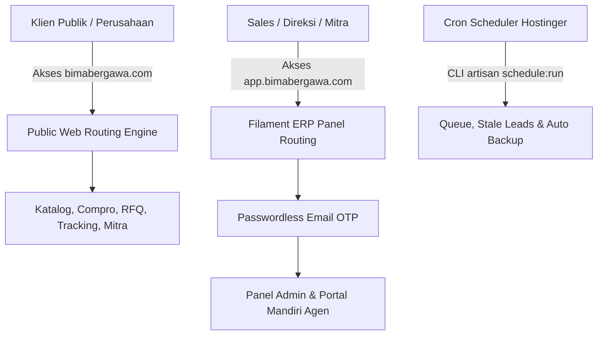

# API & Routing Specification Suite (API-Routing) - Master Index
## Proyek: B2B Multi-Brand Product Showcase & Internal Commercial ERP

| Parameter Dokumen | Keterangan Formal |
| :--- | :--- |
| **Nama Proyek** | B2B Multi-Brand Product Showcase & Internal Commercial ERP |
| **Entitas Perusahaan** | **PT. Panca Bima Bergawa** (Disingkat: **PBB**) |
| **Alamat Kantor Pusat** | Gd. Wirausaha lt.1 Unit 104, Jl. H.R. Rasuna Said Kav. C5, Setiabudi, Jakarta Selatan 12920 |
| **Nomor Dokumen** | `DOC-PBB-API-IDX` |
| **Versi Dokumen** | 1.4.0 |
| **Tanggal Efektif** | Oktober 2026 |
| **Klasifikasi Akses** | Internal Confidential & Engineering Reference |

### Riwayat Revisi Dokumen (Document Version Control)

| Versi | Tanggal | Penulis / Peran | Status | Ringkasan Perubahan |
| :---: | :---: | :--- | :---: | :--- |
| `1.0.0` | 01 Sep 2026 | Backend Lead | Draf Awal | Inisialisasi spesifikasi rute web publik & submit RFQ |
| `1.1.0` | 03 Sep 2026 | API Architect | Ditinjau | Penambahan endpoint Bulk SKU Parser, Pelacakan Resi, & Agen |
| `1.2.0` | 05 Sep 2026 | Principal System Architect | Disetujui | Pemisahan multi-domain `bimabergawa.com` vs `app.bimabergawa.com` |
| `1.3.0` | 05 Sep 2026 | Principal Integration Engineer | Disetujui | Pemisahan suite modular menjadi 4 berkas mendalam dengan standar Anti-AI & Zero Emoji |
| `1.4.0` | 03 Okt 2026 | Principal Integration Engineer | Disetujui | Penyelarasan API-03 v1.5.0 (Rute dan RBAC matrix `/admin/suppliers`, `/admin/reports` 4-Tab, serta verifikasi QR Code `/verify-doc/{type}/{hash}`) |

---

## 1. Arsitektur Topologi Routing Multi-Domain

Aplikasi beroperasi di atas satu repositori Laravel 11 dengan pemisahan rute berbasis domain dan subdomain pada layer HTTP kernel:



---

## 2. Struktur Dokumen Modular API & Routing Suite

Dokumen spesifikasi API & Routing dipecah ke dalam 4 berkas mendalam:

```
docs/03-integration-and-deployment/API-Routing/
├── README.md                                             # [Dokumen Saat Ini] Master Index & Gambaran Arsitektur
├── 01-public-web-routing-and-pages.md                    # Matriks Rute Web Publik, SEO Friendly Slugs, & Controller Action
├── 02-public-api-endpoints-and-payloads.md               # Skema JSON Request/Response, Validasi, Rate Limiting, & Error Codes
├── 03-internal-erp-filament-routing-and-rbac.md          # Rute Subdomain ERP, Panel Filament, Spatie RBAC, & DomPDF Streaming
└── 04-cron-webhooks-and-background-tasks.md              # CLI Artisan Schedule, Deteksi Stale Lead, Backup DB, & Telemetri
```

---

## 3. Matriks Referensi Antar Dokumen

| Berkas Dokumen | Fokus Utama | Target Implementasi |
| :--- | :--- | :--- |
| **`01-public-web-routing-and-pages.md`** | Halaman publik, navigasi katalog, matriks perbandingan, & sitemap XML | `routes/web.php` (Domain Root) |
| **`02-public-api-endpoints-and-payloads.md`** | Kontrak API penawaran RFQ massal, parser BOQ, pelacakan ekspedisi | `app/Http/Controllers/Api/` |
| **`03-internal-erp-filament-routing-and-rbac.md`** | Panel CRM, Quotation Builder, Surat Jalan parsial, slip komisi mitra | `app/Filament/` (Subdomain ERP) |
| **`04-cron-webhooks-and-background-tasks.md`** | Otomasi peringatan prospek tertunda ($>2\text{ jam}$), eksekusi antrean | `app/Console/Kernel.php` |
