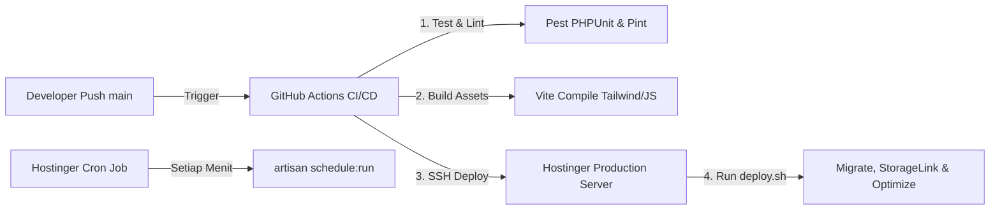

# CI/CD & Deployment Suite (CICD-Deployment) - Master Index
## Proyek: B2B Multi-Brand Product Showcase & Internal Commercial ERP

| Parameter Dokumen | Keterangan Formal |
| :--- | :--- |
| **Nama Proyek** | B2B Multi-Brand Product Showcase & Internal Commercial ERP |
| **Entitas Perusahaan** | **PT. Panca Bima Bergawa** (Disingkat: **PBB**) |
| **Alamat Kantor Pusat** | Gd. Wirausaha lt.1 Unit 104, Jl. H.R. Rasuna Said Kav. C5, Setiabudi, Jakarta Selatan 12920 |
| **Nomor Dokumen** | `DOC-PBB-DEP-IDX` |
| **Versi Dokumen** | 1.3.0 |
| **Tanggal Efektif** | September 2026 |
| **Klasifikasi Akses** | Internal Confidential & Engineering Reference |

### Riwayat Revisi Dokumen (Document Version Control)

| Versi | Tanggal | Penulis / Peran | Status | Ringkasan Perubahan |
| :---: | :---: | :--- | :---: | :--- |
| `1.0.0` | 01 Sep 2026 | DevOps Lead | Draf Awal | Alur pipeline GitHub Actions & skrip deployment SSH Hostinger |
| `1.1.0` | 03 Sep 2026 | Infrastructure Specialist | Ditinjau | Penambahan setup Cron job hPanel & optimasi LiteSpeed `.htaccess` |
| `1.2.0` | 05 Sep 2026 | Principal System Architect | Disetujui | Konfigurasi pemisahan multi-domain & caching komponen Filament |
| `1.3.0` | 05 Sep 2026 | Principal Integration Engineer | Disetujui | Pemisahan suite modular menjadi 4 berkas mendalam dengan standar Anti-AI & Zero Emoji |

---

## 1. Topologi Deployment & Lingkungan Hostinger Premium

Aplikasi dideploy ke infrastruktur **Hostinger Premium Web Hosting** dengan strategi otomatisasi berbasis GitHub Actions dan LiteSpeed Web Server:



---

## 2. Struktur Dokumen Modular CI/CD & Deployment Suite

Dokumen spesifikasi CI/CD & Deployment dipecah ke dalam 4 berkas mendalam:

```
docs/03-integration-and-deployment/CICD-Deployment/
├── README.md                                             # [Dokumen Saat Ini] Master Index & Topologi Deployment
├── 01-github-actions-pipeline-and-workflows.md           # Pipeline GitHub Actions, Pest Testing, Build Vite, & Secrets
├── 02-hostinger-server-and-webserver-config.md           # Konfigurasi PHP 8.3, OPcache, LiteSpeed .htaccess, & Subdomain Root
├── 03-deployment-scripts-and-zero-downtime.md            # Skrip deploy.sh, Maintenance Bypass, Rollback, & Cache Warming
└── 04-cron-scheduler-and-monitoring-setup.md             # Setup Cron hPanel, Queue Workers, Stale Alert, & Health Checks
```

---

## 3. Matriks Referensi Antar Dokumen

| Berkas Dokumen | Fokus Utama | Target Implementasi |
| :--- | :--- | :--- |
| **`01-github-actions-pipeline-and-workflows.md`** | Otomasi CI/CD, linting, build aset statis, pengiriman SSH | `.github/workflows/deploy.yml` |
| **`02-hostinger-server-and-webserver-config.md`** | Web server LiteSpeed, penanganan URL rewriting, multi-domain | `.htaccess` & hPanel Dashboard |
| **`03-deployment-scripts-and-zero-downtime.md`** | Skrip eksekusi rilis produksi, migrasi DB aman, pemanasan cache | `deploy.sh` di root server |
| **`04-cron-scheduler-and-monitoring-setup.md`** | Penjadwalan tugas latar belakang, antrean email, audit log | hPanel Cron Jobs & Kernel.php |
