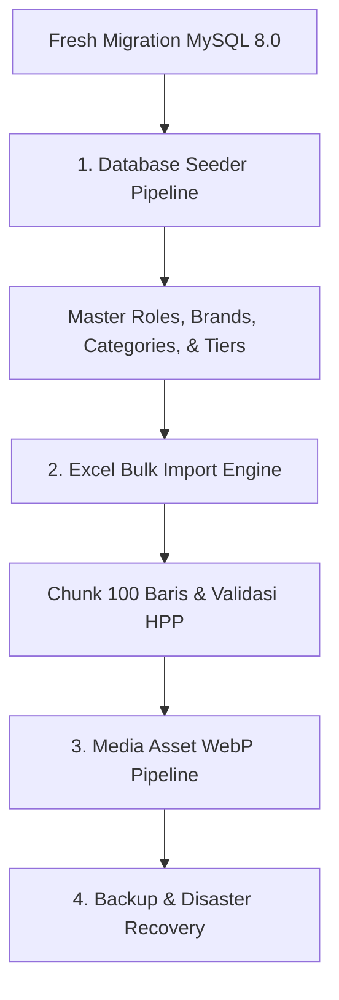

# Data Migration & Seeding Suite (Data-Migration-Seeding) - Master Index
## Proyek: B2B Multi-Brand Product Showcase & Internal Commercial ERP

| Parameter Dokumen | Keterangan Formal |
| :--- | :--- |
| **Nama Proyek** | B2B Multi-Brand Product Showcase & Internal Commercial ERP |
| **Entitas Perusahaan** | **PT. Panca Bima Bergawa** (Disingkat: **PBB**) |
| **Alamat Kantor Pusat** | Gd. Wirausaha lt.1 Unit 104, Jl. H.R. Rasuna Said Kav. C5, Setiabudi, Jakarta Selatan 12920 |
| **Nomor Dokumen** | `DOC-PBB-MIG-IDX` |
| **Versi Dokumen** | 1.5.0 |
| **Tanggal Efektif** | September 2026 |
| **Klasifikasi Akses** | Internal Confidential & Engineering Reference |

### Riwayat Revisi Dokumen (Document Version Control)

| Versi | Tanggal | Penulis / Peran | Status | Ringkasan Perubahan |
| :---: | :---: | :--- | :---: | :--- |
| `1.0.0` | 01 Sep 2026 | Database Administrator | Draf Awal | Urutan eksekusi seeder dasar & format Excel import |
| `1.1.0` | 03 Sep 2026 | Data Engineer | Ditinjau | Penambahan seeder jenjang komisi freelance & batch chunking 100 baris |
| `1.2.0` | 05 Sep 2026 | Principal System Architect | Disetujui | Penyelarasan skema 14 tabel MySQL & validasi tipe data |
| `1.3.0` | 05 Sep 2026 | Principal Integration Engineer | Disetujui | Pemisahan suite modular menjadi 4 berkas mendalam dengan standar Anti-AI & Zero Emoji |
| `1.4.0` | 19 Sep 2026 | Principal Integration Engineer | Disetujui | Penyelarasan pipeline seeder untuk 4 prinsipal resmi (Schneider, Philips, ABB, Legrand), 5 peran Spatie, & SystemSettingSeeder |
| `1.5.0` | 19 Sep 2026 | Lead Database Architect | Disetujui | Sinkronisasi menyeluruh suite seeder terhadap skema aktual (commission_tiers, users, normalisasi product_specifications) |

---

## 1. Arsitektur Inisialisasi Data & Import Katalog

Pipeline inisialisasi dan migrasi data dirancang untuk menangani jutaan baris data produk dan aset media secara terstruktur:



---

## 2. Struktur Dokumen Modular Data Migration & Seeding Suite

Dokumen spesifikasi Data Migration & Seeding dipecah ke dalam 4 berkas mendalam:

```
docs/03-integration-and-deployment/Data-Migration-Seeding/
├── README.md                                             # [Dokumen Saat Ini] Master Index & Pipeline Inisialisasi
├── 01-database-seeder-pipeline-and-roles.md              # Seeder Pipeline, Spatie RBAC, Admin Master, & Jenjang Komisi
├── 02-brand-and-category-taxonomy-seeding.md             # Master Brand Prinsipal, Kategori Hierarkis, & Atribut Teknis
├── 03-excel-bulk-catalog-import-engine.md                # Spesifikasi Template Excel, Chunking 100 Baris, & Validasi
└── 04-webp-media-assets-and-backup-recovery.md           # Konversi Gambar WebP, Brosur PDF, & Prosedur Restore DB
```

---

## 3. Matriks Referensi Antar Dokumen

| Berkas Dokumen | Fokus Utama | Target Implementasi |
| :--- | :--- | :--- |
| **`01-database-seeder-pipeline-and-roles.md`** | Inisialisasi otorisasi RBAC, pengguna awal, dan skema komisi agen | `database/seeders/` |
| **`02-brand-and-category-taxonomy-seeding.md`** | Master data 4 prinsipal resmi (Schneider Electric, Philips Lighting, ABB, Legrand) | `database/seeders/` |
| **`03-excel-bulk-catalog-import-engine.md`** | Engine import massal ribuan SKU pricelist via Filament Resource | `app/Imports/CatalogImport.php` |
| **`04-webp-media-assets-and-backup-recovery.md`** | Kompresi aset WebP $1200\text{px}$, struktur folder, & restore MySQL | `storage/app/public/` |
