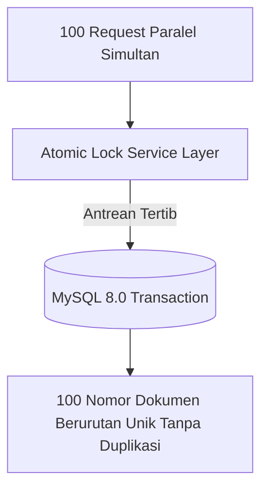

# 02. Pengujian Konkurensi, Anti-Race Condition, & Stress Test
## Quality Assurance & Testing Suite (QA-Testing)

| Parameter Dokumen | Keterangan Formal |
| :--- | :--- |
| **Nama Proyek** | B2B Multi-Brand Product Showcase & Internal Commercial ERP |
| **Entitas Perusahaan** | **PT. Panca Bima Bergawa** (Disingkat: **PBB**) |
| **Alamat Kantor Pusat** | Gd. Wirausaha lt.1 Unit 104, Jl. H.R. Rasuna Said Kav. C5, Setiabudi, Jakarta Selatan 12920 |
| **Nomor Dokumen** | `DOC-PBB-QA-02` |
| **Versi Dokumen** | 1.3.0 |
| **Tanggal Efektif** | September 2026 |
| **Klasifikasi Akses** | Internal Confidential & Engineering Reference |

### Riwayat Revisi Dokumen (Document Version Control)

| Versi | Tanggal | Penulis / Peran | Status | Ringkasan Perubahan |
| :---: | :---: | :--- | :---: | :--- |
| `1.0.0` | 01 Sep 2026 | Stress Test Engineer | Draf Awal | Kasus uji konkurensi nomor penawaran paralel |
| `1.1.0` | 03 Sep 2026 | Database Architect | Ditinjau | Penambahan uji deadlock MySQL InnoDB & Redis atomic lock |
| `1.2.0` | 05 Sep 2026 | Principal System Architect | Disetujui | Skenario simulasi 100 submission RFQ simultan |
| `1.3.0` | 05 Sep 2026 | Principal QA Architect | Disetujui | Pemisahan berkas mandiri pengujian konkurensi & zero emoji |

---

## 1. Tujuan & Skenario Pengujian Konkurensi (Concurrency Scenarios)

Pengujian konkurensi bertujuan menjamin tidak ada duplikasi data, nomor dokumen ganda (*race condition*), atau kebocoran memori saat banyak sales dan klien bertransaksi secara bersamaan:



---

## 2. Matriks Kasus Uji Konkurensi & Anti-Race Condition

| ID Uji | Target Komponen | Skenario Beban Simultan | Kriteria Keberhasilan (*Pass Criteria*) |
| :--- | :--- | :--- | :--- |
| **CT-01** | `DocumentNumberService` | 50 thread paralel meminta nomor `QUO` pada detik yang sama. | Dihasilkan 50 nomor unik berurutan (`PBB/QUO/2026/092F9C/0001` s/d `0050`) tanpa ada nomor ganda. |
| **CT-02** | `DocumentNumberService` | 50 thread paralel meminta nomor `SO` pada detik yang sama. | Dihasilkan 50 nomor unik berurutan (`PBB/SOR/2026/092F9C/0001` s/d `0050`) tanpa kegagalan deadlock. |
| **CT-03** | `POST /rfq/submit` | 100 pengguna publik mengirim formulir RFQ secara simultan. | 100 record tersimpan rapi pada `inquiries`, tidak ada HTTP 500 error. |
| **CT-04** | `CatalogImport` | 2 admin menjalankan import Excel 1.000 SKU secara bersamaan. | Proses berjalan antre tanpa melampaui batas $512\text{ MB}$ RAM server. |

---

## 3. Implementasi Skrip Pengujian Konkurensi Otomatis (Pest PHP)

```php
namespace Tests\Feature;

use App\Services\DocumentNumberService;
use Illuminate\Support\Facades\ParallelTesting;
use Spatie\Fork\Fork;

test('layanan penomoran dokumen kebal terhadap race condition saat 50 request paralel', function () {
    $results = Fork::new()
        ->concurrent(10)
        ->run(
            ...array_map(fn () => function () {
                return app(DocumentNumberService::class)->generateNextQuotationNumber();
            }, range(1, 50))
        );

    // 1. Pastikan total 50 nomor dihasilkan
    expect($results)->toHaveCount(50);

    // 2. Pastikan tidak ada satupun nomor yang duplikat (Unique Count = 50)
    $uniqueNumbers = array_unique($results);
    expect($uniqueNumbers)->toHaveCount(50);
});
```

---

## 4. Mitigasi Kegagalan Deadlock pada MySQL 8.0

1. **InnoDB Row-Level Locking:** Menggunakan `SELECT ... FOR UPDATE` di dalam transaksi tertutup.
2. **Exponential Backoff:** Jika terjadi *lock wait timeout*, `DocumentNumberService` mencoba ulang otomatis hingga 3 kali dengan interval $50\text{ ms} - 150\text{ ms}$.
