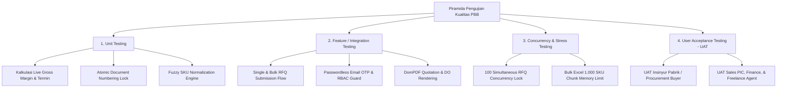

# Quality Assurance & Testing Suite (QA-Testing) - Master Index
## Proyek: B2B Multi-Brand Product Showcase & Internal Commercial ERP

| Parameter Dokumen | Keterangan Formal |
| :--- | :--- |
| **Nama Proyek** | B2B Multi-Brand Product Showcase & Internal Commercial ERP |
| **Entitas Perusahaan** | **PT. Panca Bima Bergawa** (Disingkat: **PBB**) |
| **Alamat Kantor Pusat** | Gd. Wirausaha lt.1 Unit 104, Jl. H.R. Rasuna Said Kav. C5, Setiabudi, Jakarta Selatan 12920 |
| **Nomor Dokumen** | `DOC-PBB-QA-IDX` |
| **Versi Dokumen** | 1.3.0 |
| **Tanggal Efektif** | September 2026 |
| **Klasifikasi Akses** | Internal Confidential & Engineering Reference |

### Riwayat Revisi Dokumen (Document Version Control)

| Versi | Tanggal | Penulis / Peran | Status | Ringkasan Perubahan |
| :---: | :---: | :--- | :---: | :--- |
| `1.0.0` | 01 Sep 2026 | QA Lead | Draf Awal | Inisialisasi strategi pengujian Pest PHP & kasus uji dasar |
| `1.1.0` | 03 Sep 2026 | Test Automation Specialist | Ditinjau | Penambahan uji konkurensi nomor dokumen & benchmark shared hosting |
| `1.2.0` | 05 Sep 2026 | Principal System Architect | Disetujui | Penyelarasan skenario UAT 5 persona & pengujian live margin HPP |
| `1.3.0` | 05 Sep 2026 | Principal QA Architect | Disetujui | Pemisahan suite modular menjadi 4 berkas mendalam dengan standar Anti-AI & Zero Emoji |

---

## 1. Strategi & Piramida Pengujian Kualitas Perangkat Lunak

Sistem menerapkan piramida pengujian otomatis berbasis framework **Pest PHP 2.x** dan **PHPUnit 10.x** yang terintegrasi langsung pada pipeline CI/CD GitHub Actions:



---

## 2. Struktur Dokumen Modular QA-Testing Suite

Dokumen spesifikasi Quality Assurance dipecah ke dalam 4 berkas mendalam:

```
docs/04-quality-and-security/QA-Testing/
├── README.md                                             # [Dokumen Saat Ini] Master Index & Strategi Piramida Pengujian
├── 01-unit-and-feature-test-matrix.md                    # Matriks Kasus Uji Otomatis Pest/PHPUnit (Model, Service, Controller)
├── 02-concurrency-and-load-testing.md                    # Kasus Uji Concurrency Lock, Anti-Race Condition, & Stress Test
├── 03-user-acceptance-testing-uat.md                     # Skenario UAT End-to-End Berdasarkan 5 Persona Pengguna
└── 04-performance-and-shared-hosting-benchmarks.md       # Target Benchmark TTFB, WebP Loading, & Konsumsi RAM Shared Hosting
```

---

## 3. Matriks Referensi Antar Dokumen

| Berkas Dokumen | Fokus Utama | Target Implementasi |
| :--- | :--- | :--- |
| **`01-unit-and-feature-test-matrix.md`** | Pengujian unit kalkulator margin, parser BOQ, & form RFQ | `tests/Unit/` & `tests/Feature/` |
| **`02-concurrency-and-load-testing.md`** | Verifikasi nomor dokumen unik saat transaksi paralel | `tests/Feature/ConcurrencyTest.php` |
| **`03-user-acceptance-testing-uat.md`** | Validasi skenario penerimaan pengguna dan alur operasional | Dokumen Berita Acara UAT |
| **`04-performance-and-shared-hosting-benchmarks.md`** | Audit Lighthouse, Page Load $<1.5\text{s}$, RAM $<512\text{MB}$ | Performance Profiler / Benchmark |
