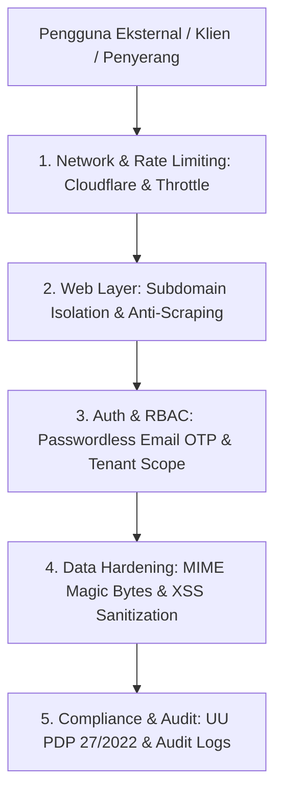

# Security Policy & Regulatory Compliance Suite (Security-Compliance) - Master Index
## Proyek: B2B Multi-Brand Product Showcase & Internal Commercial ERP

| Parameter Dokumen | Keterangan Formal |
| :--- | :--- |
| **Nama Proyek** | B2B Multi-Brand Product Showcase & Internal Commercial ERP |
| **Entitas Perusahaan** | **PT. Panca Bima Bergawa** (Disingkat: **PBB**) |
| **Alamat Kantor Pusat** | Gd. Wirausaha lt.1 Unit 104, Jl. H.R. Rasuna Said Kav. C5, Setiabudi, Jakarta Selatan 12920 |
| **Nomor Dokumen** | `DOC-PBB-SEC-IDX` |
| **Versi Dokumen** | 1.3.0 |
| **Tanggal Efektif** | September 2026 |
| **Klasifikasi Akses** | Internal Confidential & Engineering Reference |

### Riwayat Revisi Dokumen (Document Version Control)

| Versi | Tanggal | Penulis / Peran | Status | Ringkasan Perubahan |
| :---: | :---: | :--- | :---: | :--- |
| `1.0.0` | 01 Sep 2026 | CISO / Security Officer | Draf Awal | Kebijakan proteksi password, sesi, & enkripsi SSL |
| `1.1.0` | 03 Sep 2026 | Compliance Specialist | Ditinjau | Penyelarasan kepatuhan UU PDP No. 27/2022 & isolasi subdomain |
| `1.2.0` | 05 Sep 2026 | Principal System Architect | Disetujui | Penambahan audit trail Spatie Activitylog & sanitasi upload |
| `1.3.0` | 05 Sep 2026 | Principal Security Architect | Disetujui | Pemisahan suite modular menjadi 4 berkas mendalam dengan standar Anti-AI & Zero Emoji |

---

## 1. Kerangka Kerja Keamanan Siber & Kepatuhan Regulasi

Sistem mengadopsi prinsip pertahanan berlapis (*Defense-in-Depth*) untuk melindungi aset komersial, data pribadi klien (PII), dan integritas operasional:



---

## 2. Struktur Dokumen Modular Security-Compliance Suite

Dokumen spesifikasi Security & Compliance dipecah ke dalam 4 berkas mendalam:

```
docs/04-quality-and-security/Security-Compliance/
├── README.md                                             # [Dokumen Saat Ini] Master Index & Kerangka Keamanan
├── 01-authentication-and-rbac-policies.md                # Passwordless OTP, Bcrypt, Sesi HTTPS, & Spatie RBAC 5 Peran
├── 02-subdomain-isolation-and-anti-scraping.md           # Isolasi app.bimabergawa.com, X-Robots-Tag, & Throttle Matrix
├── 03-file-upload-hardening-and-sanitization.md          # Validasi Magic Bytes, UUID Renaming, & Proteksi Path Traversal
└── 04-data-privacy-and-regulatory-compliance.md          # Kepatuhan UU PDP No. 27/2022, Audit Log 90 Hari, & UU HPP PPN
```

---

## 3. Matriks Referensi Antar Dokumen

| Berkas Dokumen | Fokus Utama | Target Implementasi |
| :--- | :--- | :--- |
| **`01-authentication-and-rbac-policies.md`** | Keamanan akun internal, penegakan OTP, dan isolasi agen luar | `app/Http/Middleware/` |
| **`02-subdomain-isolation-and-anti-scraping.md`** | Proteksi perayap Google pada ERP & pencegahan bot scraping | `.htaccess` & `robots.txt` |
| **`03-file-upload-hardening-and-sanitization.md`** | Verifikasi berkas KTP, BOQ PDF, dan foto WebP aman | `App\Services\MediaOptimizer` |
| **`04-data-privacy-and-regulatory-compliance.md`** | Perlindungan data pribadi (PII), enkripsi NPWP, & audit trail | `spatie/laravel-activitylog` |
